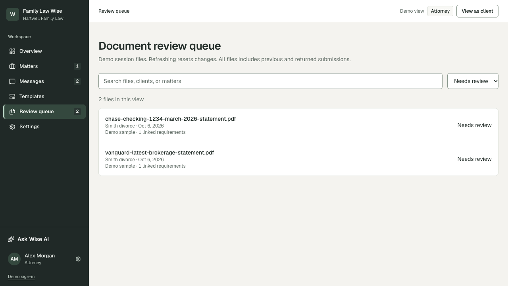
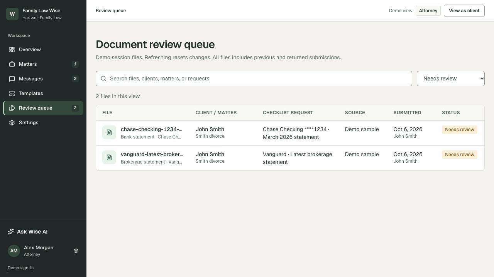
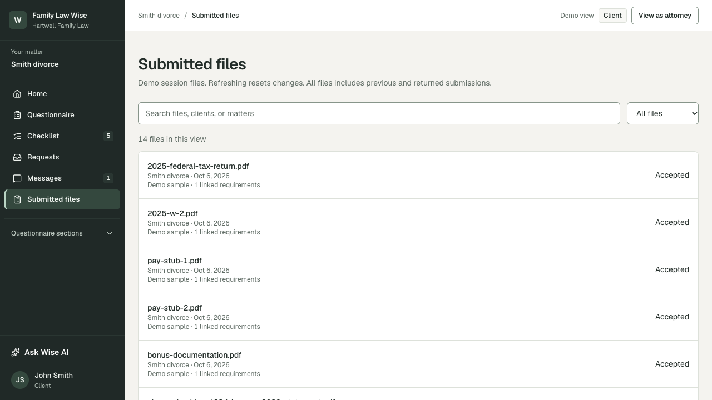
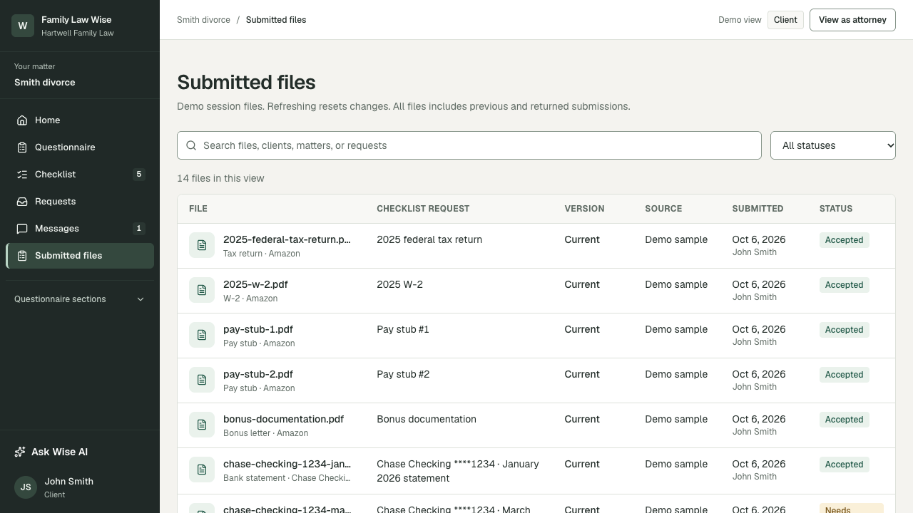
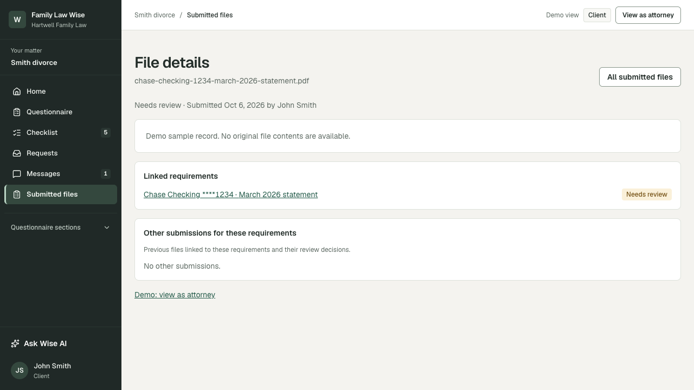
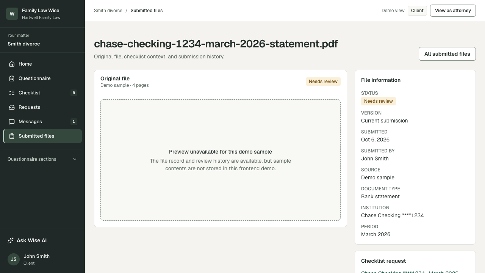

# DESK-16 review evidence

DESK-16 aligns the attorney review queue, matter document list, and client submitted-file list around one document table, then reorganizes the client file detail into a preview workspace with a fixed information rail.

## Review queue

| Before | After |
| --- | --- |
|  |  |

The queue now exposes aligned columns for the client/matter, checklist request, source, submission, and review status. Search also includes matter parties and checklist-request text.

## Client submitted files

| Before | After |
| --- | --- |
|  |  |

The client list now uses the same search and status controls, keeps same-name files as separate rows, and shows current/previous version context without hiding returned or replaced submissions.

## Client file detail

| Before | After |
| --- | --- |
|  |  |

The detail page now keeps the original file or demo-preview state in the main workspace and places status, version, source, checklist context, review metadata, and submission history in a 320px side rail.

## Acceptance coverage

- Global attorney review queue
- Matter-specific attorney document list
- Client submitted-file list and detail
- Search and status filters
- Current and previous versions
- Returned-file reason
- Removed checklist-request fallback
- Local upload versus demo-sample preview state
- Missing matter and cross-matter/missing document fallbacks

Screenshots were captured at `1280 × 720` from the same seed state. Before images use `origin/dev` at `d341ef4`; after images use this feature branch.
