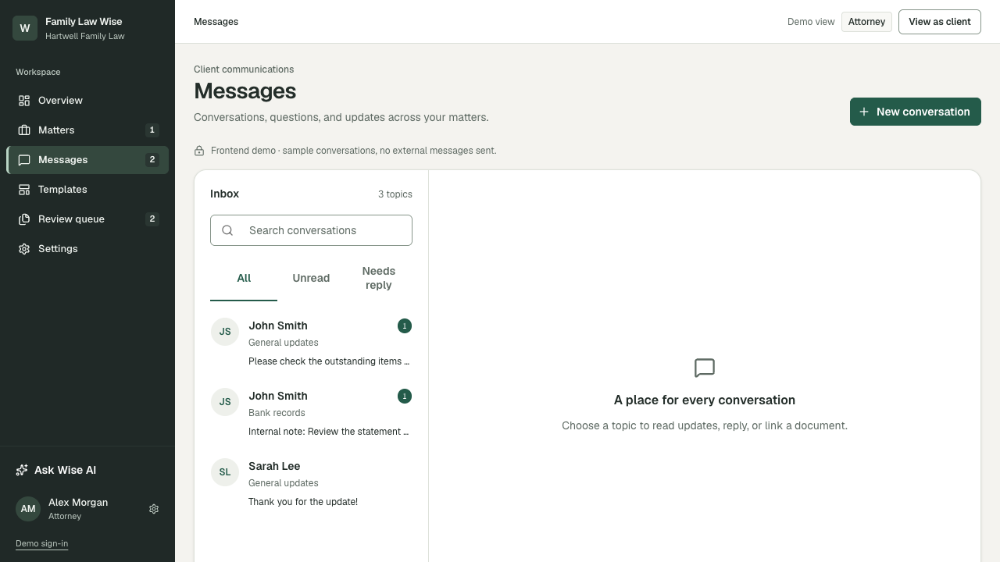

# DESK-19 — Inbox topics and conversations

## After implementation

Captured locally in the DESK-19 worktree at 1280×720. The image shows the fixed topic rail, embedded search, filter tabs, unread badges, and the right-side empty state.

## Before comparison

The prior implementation used a resizable 260–340px desktop rail, a floating search label, separator-only topic rows, and a generic empty state. No screenshot from the pre-change worktree was available during this isolated run, so this evidence folder intentionally contains only a genuine after capture rather than a reconstructed “before” image.
