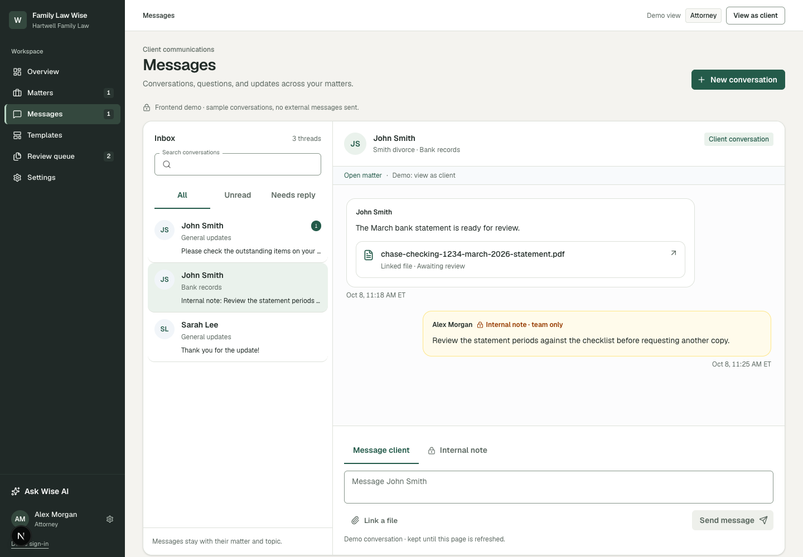
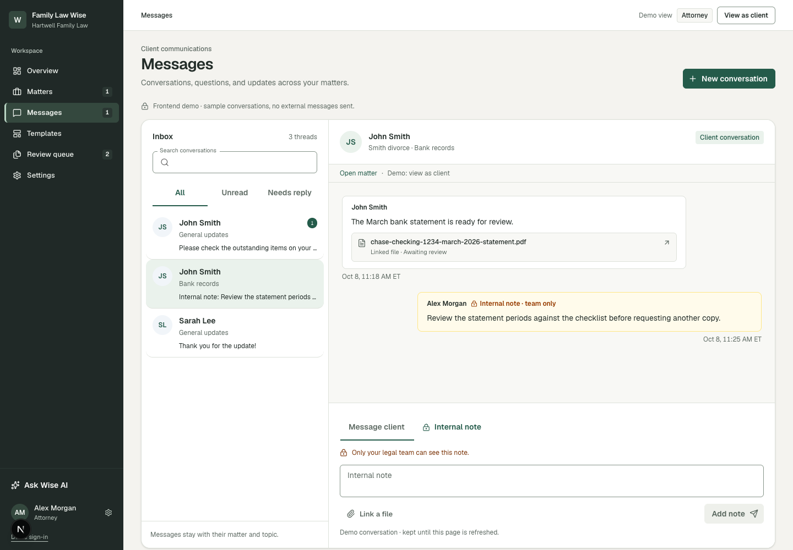

# DESK-20 review evidence

## Conversation and composer

| Before | After |
| --- | --- |
|  |  |

The selected view shows the same Bank records thread at 1440 × 1000. The updated screen places author and time on one compact line, makes the internal note visibly team-only with a warm treatment, reduces the linked document to a neutral two-line reference, and anchors the audience controls and composer along the bottom of the conversation pane.

## Acceptance coverage

- Shared messages retain sender alignment and direction.
- Internal notes keep the warm team-only treatment.
- Attorney composer clearly distinguishes “Message client” from “Internal note”.
- Audience-specific drafts remain separate through existing `draftKey` behavior.
- Linked file still opens the correct matter document; unavailable-file fallback remains.
- Message history scrolls independently; composer uses a non-shrinking bottom row.
- Existing send action, keyboard shortcut, character limit, file picker, and feedback remain wired.

The complete local design and implementation notes are in `docs/plans/DESK-20/` (gitignored by the repository).
