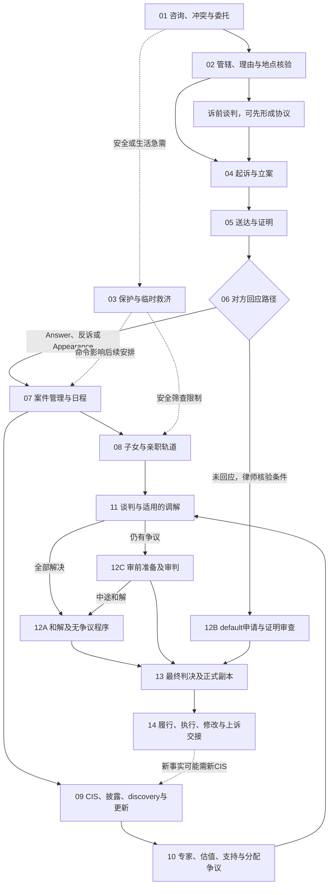

# Family Law Wise：新泽西离婚全流程与产品设计地图

核验日期：**2026-10-24**。面向：产品负责人、三名工程成员、试点律所。本文是基于官方资料的产品研究与流程设计，不代表持牌律师意见，也不是对某个当事人的法律建议。上线涉及法律判断的流程，须由负责的新泽西执业律师验收。

配套阅读：[架构基线](architecture.md)、[原 CIS 阶段计划](nj-cis-plan.md)、[原三人前端交付合同](team-frontend-handoff.md)、[项目拆解与实施路线](project-roadmap-and-work-breakdown.md)。本文只新增流程和设计指导，不修改现有 UI、法院表格或原阶段计划。

**范围修正（2026-10-24）：本文件作为法律业务背景保留。产品仅有 Attorney 和本方 Client 两个视图；用户与两位队友负责前端，老板负责后端。** 法律流程中的对方、对方律师、法院、专家和调解员不是本项目待开发的用户角色，不为他们准备账号或页面。下文完整法律流程及“产品模块”栏是历史研究参考，未进入当前开发范围；实际排期以新版[前端 breakdown](project-roadmap-and-work-breakdown.md)为准。原三人前端业务包验收后先重新分配 UI 提升，后续财务／CIS 界面按原阶段计划批准。

## 1. 先理解我们正在做哪一部分

离婚案件要解决三类事情：解除婚姻关系；决定子女、支持费和财产等争议；执行判决所确定的义务。财务资料收集与 CIS 是其中重要的一条工作流。法院的案件管理、亲职安排、财务披露和和解活动可能同时进行，不能把它们画成人人必须依次通关的表单向导。[法院流程说明](https://www.njcourts.gov/self-help/divorce/contested-uncontested)

**Family Law Wise 的近期目标仍是：让律师可靠地收齐资料，再生成有来源、可审阅的 CIS 草稿。** 这能解决真实的重复追件和财务核对问题。完整离婚流程地图帮助团队知道材料为什么收、何时会变化、下一阶段需要什么，不意味着第一版要实现所有法律流程。

本次评估剩余工作时，按照用户要求，**假设原 M1–M3 共 21 项前端业务包已全部完成并通过联合验收**。这是一项规划假设。当前分支中 M1 的实现证据与 M2/M3 的实际完成状态，仍按主审记录分别判断；本文没有执行三包前端验收。即使假设成立，真实身份、持久化、S3、邮件、服务端权限、财务事实确认和 CIS 生成仍需独立建设。

| 完成信号 | 它实际说明什么 | 还不能推出什么 |
| --- | --- | --- |
| 客户已提交 | 客户把这一轮答案、文件或无法提供说明交给律所 | 律师接受；已向对方披露；已向法院提交 |
| 材料已接受 | 律所认为某个文件版本满足某项收集要求 | 数字真实无争议；证据可采；财产归属已判定 |
| 收集完成 | 律师按该轮收集范围关闭要求或记录例外 | 全面 discovery 完成；CIS 可签署；离婚结束 |
| CIS 草稿可导出 | 指定快照已完成产品和律师审阅门槛 | 客户已签；已依法送达；法院已收件或接受 |
| 双方签署和解协议 | 双方形成书面安排，效力与范围由律师核验 | 法院已签发最终离婚判决 |
| 最终判决已录入 | 有法院的最终判决及 entry 证据 | 房产过户、退休金分割、付款等已全部落实 |
| 律所行政结案 | 律所完成自己承诺的服务与交接 | 持续支持义务终止；将来不能申请执行或修改 |

上述区分依据 [R. 5:5-9 / 5:5-10](https://www.njcourts.gov/attorneys/rules-of-court?search=5%3A5-&section=All)、[CIS 表格](https://www.njcourts.gov/sites/default/files/forms/10482_fam_cis.pdf) 和[判后修改规则 R. 5:5-4](https://www.njcourts.gov/attorneys/rules-of-court?search=5%3A5-4&section=All)；表中的产品验收语义是本产品设计决定。

## 2. 一张全景图：主干、并行轨道和出口

图中编号对应下文 `LGL-01` 至 `LGL-14`。它是产品理解图，不是法院规定的唯一办理顺序。无子女案件跳过相应子女任务；已有全面协议可能直接准备无争议结案；案件途中仍可和解；保护和临时救济可以在需要时触发。对方没有回应的 default 路径有自己的证明和通知要求，不自动经过双方签署协议的节点。[法院离婚说明](https://www.njcourts.gov/self-help/divorce)、[R. 5:5-10](https://www.njcourts.gov/attorneys/rules-of-court?search=5%3A5-10&section=All)

## 3. 法律阶段到产品的逐项映射

表中“产品模块”保留历史研究设想，**不属于已批准的页面清单或三名前端成员的 backlog**。客户负责提供事实并作出自己的决定；律师负责法律判断、程序选择和专业复核；法院负责命令和判决。当前产品围绕本方律师与客户的资料收集、沟通及后续 CIS 工作组织事实、任务和版本。

### 3.1 进入案件与程序启动

| 阶段 | 主要参与者 | 动作与输入 | 输出及关键决定 | 下一步 | 对应产品模块 | 官方依据 |
| --- | --- | --- | --- | --- | --- | --- |
| **LGL-01 咨询、冲突检索、委托与安全分流** | 潜在客户、律所接案人员、律师 | 最少必要的双方身份、关联人、现有案件、沟通安全偏好；律师检查冲突、服务范围和费用约定 | 未受理／待核查／已受理；冲突处理由律师决定；明确谁是本律所客户、谁只作为对方记录 | 可受理则进入 02；必要时立即进入 03；不受理保留适当交接记录 | 受理记录、冲突核验结果、委托范围、受限联系信息；不以“建事项”自动宣告律师关系成立 | [RPC 1.2、1.5、1.7、1.9、1.18](https://www.njcourts.gov/sites/default/files/rpc.pdf) |
| **LGL-02 管辖、居住、理由与 venue 核验** | 客户、律师 | 婚姻与居住时间线、分居情况、子女居住史、其他州／国家程序 | 律师分别核验解除婚姻的管辖、对人的管辖、子女管辖、起诉理由和县；有疑问先补证据或转介 | 能在 NJ 推进则准备起诉；可能先谈判；跨州问题单独处理 | 事实时间线、待核验项目和律师签批；不做“地址一填就判管辖” | [2A:34-10](https://lis.njleg.state.nj.us/nxt/gateway.dll/statutes/1/112/1068)、[2A:34-2](https://lis.njleg.state.nj.us/nxt/gateway.dll/statutes/1/112/1061)、[R. 5:7-1](https://www.njcourts.gov/attorneys/rules-of-court?search=5%3A7-1&section=All)、[2A:34-65](https://lis.njleg.state.nj.us/nxt/gateway.dll/statutes/1/112/1110) |
| **LGL-03 诉前材料与临时／紧急救济** | 客户、律师、法院，必要时警察或倡导人员 | 保存相关资料、整理既有命令；律师评估诉讼期间生活费、支持费、律师费、财产保护或亲职临时安排；家庭暴力走相应保护程序 | 普通动议、order to show cause、TRO/FRO 等路径及命令，彼此不能混成一个“加急按钮”；紧急安全事项无需等待收集齐全 | 命令影响接触、地址可见性和亲职安排；财务／起诉主干按可行范围继续 | 安全联系、现行命令、紧急提示、律师分流与命令义务；普通消息不是应急响应服务 | [R. 5:7-2](https://www.njcourts.gov/attorneys/rules-of-court?search=5%3A7-2&section=All)、[法院家庭暴力流程](https://www.njcourts.gov/self-help/domestic-violence) |
| **LGL-04 起诉与立案** | 原告及律师、法院工作人员 | 准备 Complaint、Summons、相应 certifications、保险披露、Confidential Litigant Information Sheet 等；按适用要求提供 CIS；确认诉求、签署、费用或减免 | 准备／签署／提交／法院收件处理分开；记录正式案号、file-stamped 文书及官方回执；退件需要补正 | 进入送达，并安排适用的回应、CIS、会议任务 | 历史研究设想：诉状包索引、版本、人工提交记录及回执；不在当前前端范围 | [法院起诉步骤及表格](https://www.njcourts.gov/self-help/divorce)、[R. 5:5-2](https://www.njcourts.gov/attorneys/rules-of-court?search=5%3A5-2&section=All) |
| **LGL-05 送达与证明** | 原告律师、获准送达者、被告、法院 | 按适用方式正式送达；保存日期、地点、方式和证明；找不到对方或境外送达由律师选择后续程序 | 送达完成必须有证据及律师核验；失败、异议、替代送达分别记录。上传至客户门户或发邀请邮件不是诉状送达证明 | 经核验的送达事件用于回应期限；未完成先解决送达问题 | 送达任务／尝试／proof、律师确认的触发日期；不以邮件“已读”推导 legal service | [法院送达说明](https://www.njcourts.gov/self-help/divorce)、[R. 5:5-10 对替代送达后通知的要求](https://www.njcourts.gov/attorneys/rules-of-court?search=5%3A5-10&section=All) |
| **LGL-06 应诉、反诉、Appearance 或 default** | 被告及律师、原告律师、法院 | 审阅 Complaint，选择 Answer、Answer and Counterclaim 或 General Appearance；原告处理反诉。无回应时律师核查期限、有效送达及相关保护 | Appearance 仍可要求就财产、支持、子女问题被听取；default entry 与 default judgment 分开；缺席前需服役身份等核验 | 有争议进入 07；全面和解转 12A；符合条件申请 default 后进入 12B | 回应文书／诉求／争议议题，default 人工核验；不能把门户未登录当未应诉 | [法院回应说明](https://www.njcourts.gov/self-help/divorce/responding-complaint)、[R. 5:5-10](https://www.njcourts.gov/attorneys/rules-of-court?search=5%3A5-10&section=All)、[R. 5:7-9](https://www.njcourts.gov/attorneys/rules-of-court?search=5%3A7-9&section=All) |

**管辖的几个容易混淆的地方。** 常见 irreconcilable differences 路径涉及一方起诉前连续在 NJ 居住 12 个月，以及导致婚姻破裂的分歧持续六个月、没有合理和好前景。分居作为另一项法定理由，要求在不同住所连续分居至少 18 个月；不是所有离婚都要先分居 18 个月。一般居住要求及 adultery 等例外必须按 2A:34-10 核验，不写成所有案件一刀切的资格测试。其他理由包括遗弃、extreme cruelty 等，由律师选择并核验证据；软件不替客户推荐用哪一项。[2A:34-2](https://lis.njleg.state.nj.us/nxt/gateway.dll/statutes/1/112/1061)、[2A:34-10](https://lis.njleg.state.nj.us/nxt/gateway.dll/statutes/1/112/1068)

Venue 也不等于“现地址所在县”。R. 5:7-1 先看起诉理由产生时原告的 domicile，再按被告当时的 domicile、起诉或送达时住所等顺序回退。官方自助网页的“最后共同居住县”是简化说明，产品应保存住所与事件时间线，让律师使用规则正文判定。子女 initial custody jurisdiction 另受 2A:34-65 等规范；父母可以在 NJ 离婚，不等于 NJ 必然能决定孩子的监护问题。[R. 5:7-1](https://www.njcourts.gov/attorneys/rules-of-court?search=5%3A7-1&section=All)、[2A:34-65](https://lis.njleg.state.nj.us/nxt/gateway.dll/statutes/1/112/1110)

### 3.2 诉讼期间的并行工作

| 阶段 | 主要参与者 | 动作与输入 | 输出及关键决定 | 下一步 | 对应产品模块 | 官方依据 |
| --- | --- | --- | --- | --- | --- | --- |
| **LGL-07 案件管理与日程** | 法官、双方律师、当事人 | 根据争议、复杂度、已交文书和必要 discovery 参加 Case Management Conference | Case Management Order 确定发现期限、后续事件、专家或审判安排；法院可调整 | 同时推动 08／09／10，进入适用的和解活动 | 法院事件、命令、责任人、来源及已核验期限；法律进度不由文件百分比推算 | [R. 5:5-7](https://www.njcourts.gov/attorneys/rules-of-court?search=5%3A5-7&section=All) |
| **LGL-08 子女、custody 与 parenting 轨道** | 父母、律师、法院、获指派调解员／专家 | 收集居住史、既有命令、学校、日常照护、日程、安全问题；按适用安排参加教育或亲职调解，准备 Parenting Plan | 子女最佳利益和安全是法律判断；法律决策权、居住／照护安排、亲职时间应分开；有争议可能需评估及法院听审 | 达成部分／全部安排，或保留争议交审判；既有保护命令持续控制接触安排 | 子女事实和计划、命令版本、特殊可见性、课程／调解任务；不提供“自动争取监护权”建议 | [9:2-4](https://lis.njleg.state.nj.us/nxt/gateway.dll/statutes/1/7155/7160)、[R. 1:40-5(a)](https://www.njcourts.gov/attorneys/rules-of-court?search=1%3A40-5&section=All)、[法院离婚流程](https://www.njcourts.gov/self-help/divorce) |
| **LGL-09 CIS、财务披露、discovery 与更新** | 双方各自客户及律师、法院 | 客户向自己律师交事实；律师核对收入、两套生活预算、资产负债和附件；适用时 filing/serving CIS；正式 discovery 可含文件请求、interrogatories、depositions 等 | CIS 及其修订、正式交换记录、缺项／异议／争议；给律师上传材料不等于向对方正式披露。新事实需要复查，旧 CIS 不能被覆盖 | 支持临时动议、专家、和解及审判；情况变化时持续更新 | 现有核心：问卷、要求、文件、审阅、追件；后续：事实来源、CIS、正式披露／补正台账 | [R. 5:5-1 / 5:5-2 / 5:5-4](https://www.njcourts.gov/attorneys/rules-of-court?search=5%3A5-&section=All)、[CN 10482](https://www.njcourts.gov/sites/default/files/forms/10482_fam_cis.pdf) |
| **LGL-10 专家、估值、财产与支持争议** | 律师、客户、必要的财务／估值／职业或其他专家、法院 | 对房产、企业、退休金、债务、收入能力及争议财务事实分析；核查税务影响和支持工作表 | 可分配性、估价日期、可信估值、分配比例、alimony、child support 由法律与专业判断决定；事实与主张必须分开 | 形成谈判范围、专家意见或待审判问题；缺资料则回到 09 | 争议登记、专家资料包、意见版本、律师采用记录、正式工作表附件；不自动输出公平分配或支持费结论 | [2A:34-23](https://lis.njleg.state.nj.us/nxt/gateway.dll/statutes/1/112/1084)、[2A:34-23.1](https://lis.njleg.state.nj.us/nxt/gateway.dll/statutes/1/112/1090)、[CN 10482 Part G](https://www.njcourts.gov/sites/default/files/forms/10482_fam_cis.pdf) |
| **LGL-11 谈判、ESP 与经济调解** | 当事人、各自律师、ESP panelists、合格调解员、法院 | 依据已披露事实整理争议议题；可在诉前或诉中谈判；按法院转介参加 Early Settlement Program，再按适用规则进入 post-ESP 经济调解或其他 CDR | 部分和解／全面和解／仍有争议；参与要求不等于必须接受方案。调解员不是任一方律师。家暴案件先核验专门排除／参加条件 | 全部解决进入 12A；未解决部分进入 12C；缺事实回到 09／10 | 和解议题、提案和版本、会议任务、保密工作区；不把 ESP 建议当命令 | [R. 5:5-5 / 5:5-6](https://www.njcourts.gov/attorneys/rules-of-court?search=5%3A5-&section=All)、[R. 1:40-5(b)](https://www.njcourts.gov/attorneys/rules-of-court?search=1%3A40-5&section=All)、[经济调解说明](https://www.njcourts.gov/courts/family/family-econ-mediation) |

**子女轨道的安全分支必须具体实现。** R. 1:40-5(a)(1) 对生效中的家庭暴力 preliminary/final order 禁止转介普通 custody／parenting-time mediation。没有该命令但存在家庭暴力、虐待或性虐待问题时，也不能让系统推断“没有风险”：规则区分亲职争议与不可在该调解中处理的虐待问题，并提供以 good cause 请求退出的路径。产品应把筛查结果交律师与法院，不自动安排双方共享空间或直接联系。[R. 1:40-5(a)(1)](https://www.njcourts.gov/attorneys/rules-of-court?search=1%3A40-5&section=All)

经济调解的规则不同：有效 TRO 下不转介；有 FRO 时，只有满足专门 Domestic Violence Economic Mediation 条件、受害方同意、使用获准处理该类案件的调解员等，才可能进入相应项目；该项目禁止双方直接交换资料。不能把“一方愿意调解”作为绕过保护措施的按钮。[R. 1:40-5(b)](https://www.njcourts.gov/attorneys/rules-of-court?search=1%3A40-5&section=All)

**CIS 与 discovery 的关系。** CIS 是财务披露表，不会取代全部证据开示。R. 5:5-2 的一般适用范围包括非 summary 的争议家事案件中 custody、support、alimony 或 equitable distribution 问题；不能只凭“没有工资收入”或“双方同意离婚”省略核验。具体 filing、service、附件和例外由律师确定。律师标记“收集完成”只关闭本轮产品要求；以后增加正式请求、发现新账户或财务变化时可以重开。[R. 5:5-1 / 5:5-2](https://www.njcourts.gov/attorneys/rules-of-court?search=5%3A5-&section=All)

**财产与支持费的专业判断。** 账户名下属于谁、事实由谁提供、某项资产是否可公平分配，是三个不同字段。Equitable distribution 需要考虑法定因素，不是系统将每个金额除以二。Alimony 有类型及多项法定因素，不应先造统一比例公式。Child support 的正式 guideline worksheet 可作为律师提供的附件；原计划明确不实现官方 Appendix IX 计算器。若以后开发计算器，需要独立的规则版本、边界案例和律师验证项目。[2A:34-23](https://lis.njleg.state.nj.us/nxt/gateway.dll/statutes/1/112/1084)、[2A:34-23.1](https://lis.njleg.state.nj.us/nxt/gateway.dll/statutes/1/112/1090)、[CIS Part G 第 11 项](https://www.njcourts.gov/sites/default/files/forms/10482_fam_cis.pdf)

### 3.3 三种结案路径与判后工作

| 阶段 | 主要参与者 | 动作与输入 | 输出及关键决定 | 下一步 | 对应产品模块 | 官方依据 |
| --- | --- | --- | --- | --- | --- | --- |
| **LGL-12A 和解及无争议程序** | 双方、各自律师、法院 | 确认所有相关议题已处理，准备／签署 MSA 或 PSA、拟议判决及必要认证；按法院要求听审或申请适用的书面处理 | 签约、提交、法院处理三件事分别记录；书面处理有适用条件，法官仍可要求出庭 | 只有取得法院最终判决证据才进入 13 | 全面／部分协议、未解决议题、已签版本、律师批准、结案材料包 | [法院无争议说明](https://www.njcourts.gov/self-help/divorce/contested-uncontested)、[Directive 01-25](https://www.njcourts.gov/attorneys/directives/01-25)、[CN 12620](https://www.njcourts.gov/sites/default/files/forms/12620_cert_divorce_papers.pdf) |
| **LGL-12B default 证明及法院审查** | 原告及律师、法院；依法需要通知的被告 | 核实 default 已进入、送达、服役身份；请求财产／支持等救济时，按规则送 Proposed Final Judgment Notice、CIS 等；适用时申请 on-the-papers | 未回应不是对所有金额／安排的同意；default 不等于自动获准全部诉求；书面 property settlement 的规则例外由律师处理 | 法院审查／听审／要求补正／作出判决；对方申请撤销 default 等交律师决定 | default 条件清单、通知证明、拟议救济及证据包；与双方和解独立 | [R. 5:5-10](https://www.njcourts.gov/attorneys/rules-of-court?search=5%3A5-10&section=All)、[R. 5:7-9](https://www.njcourts.gov/attorneys/rules-of-court?search=5%3A7-9&section=All)、[Directive 01-25](https://www.njcourts.gov/attorneys/directives/01-25) |
| **LGL-12C 争议审前准备及审判** | 双方及律师、证人／专家、法官 | 按 case management order 准备证据、证人、专家报告、争点和相关文书；审理未解决问题 | 法官基于证据及法律裁判；途中可部分／全面和解。先解除婚姻、财产以后再审的 bifurcation 不是默认通道 | 形成最终判决或后续命令；必要时交律师评估其他程序 | 审前任务、争议／证据索引、正式版本、事件；不自动判断证据可采或胜诉概率 | [R. 5:5-7](https://www.njcourts.gov/attorneys/rules-of-court?search=5%3A5-7&section=All)、[R. 5:7-8](https://www.njcourts.gov/attorneys/rules-of-court?search=5%3A7-8&section=All)、[法院争议案件说明](https://www.njcourts.gov/self-help/divorce/contested-uncontested) |
| **LGL-13 最终判决** | 法官、双方律师、当事人 | 核对已 entered 的 Final Judgment、纳入的协议及既有命令、日期和副本；向客户解释下一步义务 | 法律关系与各项裁决以正式文书为准；最终判决、修正判决、草拟判决分别保存 | 立即列出判后义务和相关法律期限；转 14 | 判决台账、正式副本、entry 证据、义务清单和律师解释；只有律师核验后更新法律状态 | [R. 5:5-9](https://www.njcourts.gov/attorneys/rules-of-court?search=5%3A5-9&section=All)、[法院判决记录说明](https://www.njcourts.gov/self-help/divorce) |
| **LGL-14 判后落实、执行、修改与上诉交接** | 客户、律师、相关机构／计划管理员、法院 | 根据实际判决跟踪付款、资产／房产手续、适用的退休计划分割、保险及亲职安排；违约或情况变化交律师评估执行／修改；上诉交专门程序 | 每项义务有负责人、期限来源和完成证据；修改与执行是新法律事件，不覆写原判决。法院判决已结束婚姻，持续义务仍可存在 | 履行完成并交接后行政结案；新申请建立关联工作流；保留旧事实与 CIS | 判后任务、履行证据、保留／关闭／重开、上诉交接包；无默认自动扣款或处分财产 | [R. 5:5-4](https://www.njcourts.gov/attorneys/rules-of-court?search=5%3A5-4&section=All)、[法院判后申请](https://www.njcourts.gov/self-help/post-judgment)、[DOL QDRO 指引](https://www.dol.gov/agencies/ebsa/about-ebsa/our-activities/resource-center/publications/qdros-practical-guide)、[上诉规则与手册](https://www.njcourts.gov/sites/default/files/attorneys/ecourts/civilappeal.pdf) |

判后最直观的例子是退休金：对于受 ERISA 覆盖的退休计划，判决中写了“分给另一方一部分”仍须满足有效 QDRO 等适用要求，并由计划管理员按程序判定。不同计划不能一律套用同一流程；产品追踪专业人员确认的文书和落实证据，不自行生成具有法律效力的退休金分割指令。[美国劳工部 QDRO 指引](https://www.dol.gov/agencies/ebsa/about-ebsa/our-activities/resource-center/publications/qdros-practical-guide)

判后修改也说明为什么旧 CIS 不能删除：R. 5:5-4 对建立支持、执行、一般修改以及基于退休的修改分别规定附件要求；某些申请需要当前和先前的 CIS，且对方何时应提交当前 CIS 与具体程序有关。不得把所有判后事项统一成“双方先重新填一份 CIS”。[R. 5:5-4(a)(2)–(5)](https://www.njcourts.gov/attorneys/rules-of-court?search=5%3A5-4&section=All)

## 4. 用一个假想案件走一遍

以下全是虚构，目的是解释产品如何帮助流程，不是预测结果。

Alex 找到一家 NJ 律所，想与 Morgan 离婚。有一个未成年子女、共同住房、两个银行账户、各自工资和一个退休计划。双方是否已符合所有管辖条件，先由律师核验。

1. **先接案。** 律所确认冲突检索、代理范围和安全联系方法。系统创建客户事项，Morgan 只作为对方记录；不会自动邀请 Morgan 进入 Alex 的文件与消息空间。
2. **先收一轮财务材料。** Alex 填就业、账户和税务问卷，系统生成“这两个账户在本轮指定月份的对账单”等要求。律师退回一份缺页文件；Alex 补交；旧版本保留。律师将本轮标成“收集完成”。此时离婚仍可能尚未立案。
3. **律师准备并在官方渠道起诉。** 受理记录与送达证明回到产品。系统不会从“邀请邮件已发送”推导 Morgan 已被法律送达。律师确认真实送达日与回应任务。
4. **分支 A：Morgan 及时应诉。** 法院安排案件管理。子女计划与财务 CIS 同时推进；Alex 租了新住所后，现有预算改变，需要律师评估更新 CIS。初次收集进度 100% 并不能锁死后续补件。
5. **分支 B：Morgan 没有回应。** 律师核验 default 条件、服役身份及所求救济，准备适用的通知和证明。系统显示“待法院处理缺席程序”，不会替双方生成一份“已同意协议”，也不会显示“自动离婚”。
6. **分支 C：出现安全风险或保护令。** 系统立即提供官方紧急路径，并把安全联系与文件可见性问题交律师。普通子女调解流程暂停自动推进；经济调解是否适用另行核验专门条件。不能用一个“有孩子→调解”规则继续安排双方直接交流。
7. **回到有争议主干。** 双方可能已同意亲职日程，但对住房价值和支持费有分歧。律师选择是否需要估值专家，整理事实与主张，再参加适用的 ESP／经济调解。若全面协议达成，走 12A；若仍有部分争议，走 12C。系统允许“子女议题已解决、财产仍争议”同时存在。
8. **法院最终判决后继续落实。** 法律阶段变为“已取得最终判决”。住房手续、退休计划分割和支付安排分别排任务、收完成证据。退休金任务没有完成，不改变已存在的离婚判决；它表明判后实施尚未完成。

这个例子中，第一版实际解决的是第 2 步以及其后的补件闭环；后续财务／CIS 按原计划分阶段启动。其余法律事务由律师在产品外处理，不因出现在例子里就新增产品任务。[上述法律分支来源：法院流程](https://www.njcourts.gov/self-help/divorce/contested-uncontested)、[R. 5:5](https://www.njcourts.gov/attorneys/rules-of-court?search=5%3A5-&section=All)、[R. 1:40-5](https://www.njcourts.gov/attorneys/rules-of-court?search=1%3A40-5&section=All)

## 5. 两端产品设计：律师与本方客户

以下均为产品设计建议；法律门槛仍由前文来源及律师核验。

### 5.1 仅两个产品视图

| 角色 | 主要工作 | 默认可见 | 明确限制 |
| --- | --- | --- | --- |
| 本方客户 | 提供事实、上传、解释无法提供、查看律师要求、确认自己的陈述 | 自己被授权事项的客户区与共享消息、批准给客户看的文件 | 看不到内部备注、其他客户、另一方私有资料、未分享的专家／策略工作区 |
| 负责律师 | 决定法律路径、审阅、确认事实、批准草稿和对外内容 | 被授权事项的业务数据、内部工作及共享信息 | 冲突、特殊保护资料或角色分工仍可能限制访问；律师身份不等于全律所无条件通行 |

对方及其律师、法院、专家／调解员是业务背景中的参与者，没有本项目账号或工作台。律所助理、管理员也不另立产品视图或新增本轮权限角色。现有律师端设置保留在 Attorney view。AI 是两端内的功能入口，不是第三类用户。

系统和 AI 只能使用当前用户获准访问、且该用途需要的数据；客户 AI 不得读取内部备注。服务端和数据库权限由老板实现，三名前端成员负责两端展示、交互和授权失败等界面状态。

内部备注和客户消息应有显式 `visibility`，在服务端和数据库权限执行，不能只靠客户端隐藏。发布客户消息前显示将发送给谁；文件关联固定到正确的文档版本。受保护地址、孩子敏感资料和安全联系方式不能出现在邮件标题、通知摘要、默认导出或 AI 摘要中。

“内部备注”只是产品可见性分类，不是对 attorney-client privilege 或 work-product protection 的法律认定；特权、可发现性与披露由律师决定。[RPC 保密与代理责任](https://www.njcourts.gov/sites/default/files/rpc.pdf)

### 5.2 导航按工作安排，法律阶段作为上下文

| 区域 | 建议入口 | 首屏最应回答的问题 |
| --- | --- | --- |
| 律师全局 | 工作队列、事项、消息、模板／设置 | 今天谁在等我？哪个事项有截止或补正？ |
| 事项核心 | 概览、问卷、要求清单、文件、审阅、消息、活动 | 本轮还缺什么？谁负责？哪些文件／事实已变化？ |
| CIS 扩展 | 收入与财务事实、两套月预算、资产负债、CIS 草稿／版本 | 数字从哪里来？谁确认？哪些信息仍不够？ |
| 客户端 | 当前下一步、问卷、待交材料、我的文件、律师消息、已分享的案件更新 | 我今天只需完成哪几件事？完成后等谁？ |

当前不为十四个法律阶段新增菜单或工作区。律师概览围绕本轮收集和关键待办；客户端使用白话解释，例如“律师正在核对你交的材料”。后续 CIS 导航需按对应业务阶段批准，法院程序管理没有纳入当前 breakdown。

### 5.3 拆开六套状态，不让一个 COMPLETE 承担全部含义

`src/lib/types.ts` 现有 `MatterStatus` 从 DRAFT 到 COMPLETE，语义是当前收集工作流。未来持久化时，可保留兼容映射并明确命名为 `collection_status`；无需在本次文档任务里更改代码。

下表用于防止概念混淆，不要求现在实现六套状态机。当前前端使用收集／要求／文件状态；CIS 属于后续已批准业务阶段。法律案件和正式披露状态仍是研究概念，老板负责获批范围内的服务器状态与约束。

| 状态维度 | 建议的语义 | 谁推动、依据是什么 |
| --- | --- | --- |
| 法律案件阶段 `legal_case_stage` | 未立案、已立案／送达中、回应中、诉讼中、判决待处理、已判决、判后程序、行政关闭等；同时保存并行轨道 | 律师依据文书／法院事件核验；不是自动按收集进度推进 |
| 披露轮次 `disclosure_status` | 本轮准备、待审、批准交换、已交换、需更新 | 有范围、基准日、接收方和批准版本；正式交换另需证据 |
| 收集状态 `collection_status` | 邀请、填写、客户提交、律师审、等补件、收集完成／重开 | 现有 M1/M2 闭环及律所批准的收尾规则 |
| 要求 `requirement_status` | 缺失、已请求、上传／待审、接受、无法提供、不适用、豁免 | 客户只能提出无法提供说明；是否满足／豁免由授权人员决定并留理由 |
| 文件／版本 `document_status` | 上传流程状态独立于审阅结果；待审、接受、退回、已替换／历史版本 | 新版本不能继承旧版本的接受决定；一个文件可支持多项要求，但决定应能追到版本和要求 |
| CIS `cis_status` | 未开始、草稿、缺项、待律师审、审阅快照、已导出；签署／送达／提交另有证据记录 | 确定性映射和律师确认；导出不能自动设为“已提交” |

金额也需要独立生命周期：客户自报／文件抽取候选 → 人工确认事实 → 被某个 CIS 快照采用 → 源信息变化后待复查。每个值保留单位、期间、归属、是否估计、来源文件版本与页码、确认人和时间。**“未知”“0”“不适用”“有争议”不能共用空字符串解释。** 银行名称改变、账户删除或新文件替换时，保留历史关系和既有导出，供律师追溯。

### 5.4 三类 Wise AI 行为

| 模式 | 可以做什么 | 交付边界和例子 |
| --- | --- | --- |
| **Next steps** | 从授权事项的确定性状态提出下一项操作，附可用入口、责任人和根据 | “律师退回 3 月对账单，原因是缺第 2 页。打开补交。”；不能说“你已经满足法院所有披露义务” |
| **General information** | 使用经律师批准、版本化的官方资料解释程序和术语；显示来源、核验日及适用范围 | “CIS 是什么”“ESP 做什么”；来源冲突／过期时停止给肯定答案并转人工核验 |
| **Case-specific legal question** | 帮用户整理问题和相关事实，生成可编辑的转律师草稿 | “我能搬走孩子吗”“是否接受这个数额”“要不要申请 default”均由律师判断；用户选择发送内容，不连带泄露内部或私有 AI 会话 |

紧急安全问题单独处理：及时显示官方紧急说明和安全联系入口，不让用户等待普通消息队列。法院家庭暴力页面指引紧急情况拨打 911，并说明法院关闭时可到当地警察部门申请相应保护程序；产品应保持这类入口的来源和更新机制，不承诺 AI 或律所收件箱实时响应。[法院家庭暴力帮助](https://www.njcourts.gov/self-help/domestic-violence)

一般问答进入真实产品前，必须验证引用确实支持回答、上下文权限、旧答案失效、输入文件中的恶意指令以及转律师的用户控制。真实模型可关闭；人工收集、确认事实和 CIS 映射仍应完整运行。M3 的演示回复和导航完成不等于已具备真实法律问答能力。

## 6. 期限要记录“从什么事件开始”，不能只存一个日期

下表是已核验的典型规则，用于说明未来产品的期限模型，**不是可以直接启用的通用日历算法**。律师须确认适用性、实际触发事件、法院命令、计算规则、送达方式和例外。即使日数已知，也不能从客户猜测的日期自动生成最终法律截止。

| 事项 | 规则中的基准 | 产品必须有的触发证据／核验 | 来源 |
| --- | --- | --- | --- |
| 回应离婚诉状 | 法院说明：被送达后 35 天回应 | 送达方式与有效日期、送达证明、是否有延长／其他适用程序；不从立案日或邀请日算 | [Responding to a Divorce Complaint](https://www.njcourts.gov/self-help/divorce/responding-complaint) |
| 初始 CIS 或不需要 CIS 的认证 | 一般在 Answer 或 Appearance **filed 后 20 天**，或法院指定的其他时间；R. 5:7-2 有相关例外 | 谁提交了何种回应、filed 日期、是否需 CIS、适用法院命令 | [R. 5:5-2(b)](https://www.njcourts.gov/attorneys/rules-of-court?search=5%3A5-2&section=All) |
| CIS 变化与补正 | 持续披露 material changes；修订最迟 final hearing 前 20 天提交 | 新事实、是否重大、final hearing 日期及命令；此条不意味着可以等到最后 20 天才处理重大变化 | [R. 5:5-2(c)](https://www.njcourts.gov/attorneys/rules-of-court?search=5%3A5-2&section=All) |
| 临时支持／费用申请 | 申请与回应应附 CIS；已交 CIS 的相关修订最迟 motion hearing 前 8 天 | 申请类型、已有 CIS、动议听审日和法院要求 | [R. 5:7-2(a)](https://www.njcourts.gov/attorneys/rules-of-court?search=5%3A7-2&section=All) |
| Case Management Conference | 标准／快速轨道规则以最后允许回应期结束后 30 天为基准；其他轨道有不同表述 | 案件轨道、最后回应期限、实际法院通知；不是向用户承诺 30 天内必然开会 | [R. 5:5-7](https://www.njcourts.gov/attorneys/rules-of-court?search=5%3A5-7&section=All) |
| Discovery | 快速轨道通常原 complaint 送达后 90 天，标准轨道 120 天；priority／complex 依 case management order | 原诉状送达、案件轨道、命令及延期；不等于“离婚应在 90／120 天完成” | [R. 5:5-1(e)](https://www.njcourts.gov/attorneys/rules-of-court?search=5%3A5-1&section=All) |
| ESP 材料 | 已转介案件，panel 前最迟 5 天提供相应 submission | 适用转介、实际 panel 日期、收件对象、所需材料和提交证据 | [R. 5:5-5](https://www.njcourts.gov/attorneys/rules-of-court?search=5%3A5-5&section=All) |
| Default 拟议判决通知 | 已进入 default 且请求相应救济的案件，通常 hearing 前不少于 20 天；书面 property settlement 等例外需核验 | default entry、所求救济、听审日、送达方式、协议及规则例外 | [R. 5:5-10](https://www.njcourts.gov/attorneys/rules-of-court?search=5%3A5-10&section=All) |
| 一般家事动议 | 通常 notice/moving papers 为 return date 前 24 天，对应回应／cross-motion 15 天、reply 8 天；邮寄有附加时间规则 | 具体动议、法院日期、方式、例外、送达与 filing 两条证据 | [R. 5:5-4(c)](https://www.njcourts.gov/attorneys/rules-of-court?search=5%3A5-4&section=All) |
| 上诉交接 | 一般民事 final judgment 的 45 天规则存在适用、终局性及中止／延长问题 | 由上诉律师核验 entered 日期、可上诉性、相关动议影响；一收到判决即交接，不等倒计时到尾声 | [官方 eCourts Appellate 手册](https://www.njcourts.gov/sites/default/files/attorneys/ecourts/civilappeal.pdf)、[法院上诉说明](https://www.njcourts.gov/self-help/divorce/appealing-contested-case) |

每条未来 `deadline` 至少需要：事项与程序、规则／命令来源、来源版本、触发事件与证据、触发日期、计算草稿、核验人／时间、适用时区、负责人、提醒计划、覆盖它的新命令及历史。来源未知时显示“待律师确认”，而不是给用户一个看似确定的倒计时。

律所“第 3 天提醒客户”“第二次催件”等是**服务政策**；法院 deadline 是**法律程序要求**。两者分开命名、存储、配置。样例银行材料的 **2026 年 1–3 月** 是演示基准；“每个账户近三个月”也是当前收集试点的产品范围，不是 NJ 所有离婚的普遍法定资料期间。实际请求可因 CIS、discovery、律师策略或法院命令更广。[原收集范围](nj-cis-plan.md)、[CIS 实际说明页](https://www.njcourts.gov/sites/default/files/forms/10482_fam_cis.pdf)

## 7. CIS 表格版本与现有计划需要澄清的细节

本次从法院离婚页面的正式链接下载了 CN 10482，使用 PDF 文本提取并目视核对第 1 和第 12 页。**实际文件为 12 页，页脚是 Revised: 08/2025, Effective: 09/01/2025, CN:10482。** 与 `nj-cis-plan.md` 的版本日期一致；本次没有发现该日期需要改版。R. 5:5-2(b) 当前表述为 Administrative Director 规定的表格；实施时应下载现行 CN 文件并保存版本，不能恢复使用旧 Appendix V。[官方 CIS](https://www.njcourts.gov/sites/default/files/forms/10482_fam_cis.pdf)、[现行 R. 5:5-2](https://www.njcourts.gov/attorneys/rules-of-court?search=5%3A5-2&section=All)

| 核验项 | 官方内容／本次发现 | 产品含义与原计划关系 |
| --- | --- | --- |
| 表格范围 | Part A 案件／当事人，B 就业等资料，C 收入，D 月预算，E 资产负债，F 特殊问题，G 附件 | 第一批工资、账户和税表只能覆盖一部分；财务画像页面不等于完整 CIS |
| 收入与预算 | 附件包括最新联邦和州税表及附件、上一公历年的 W-2／1099／K-1、最近三张工资单等；Part D 有婚姻期间及当前两列，按 4.3 周／月 | 首版只收最近一年联邦税表是刻意缩小的试点范围；达到完整 CIS 前必须补齐相应条件资料，不得把试点宣称全面合规 |
| 24 个月资料 | 表格说明月支出应审视实际支出，可参考过去 24 个月支票、银行及信用卡记录；估计须注明 | 不把“每个账户三个月对账单”当作生活预算或 discovery 的全部要求 |
| Part G 其他附件 | 涉及保险、既有家事程序／有效命令、双方协议、适用 Appendix IX worksheet、大学费用资料等 | 按事项适用性与律师决定建立附件槽；不能自动生成未知协议、法律文书或支持费结论 |
| 三项 certification | 第 12 页有三项认证陈述，**共用一个 DATED／SIGNED 区** | 原计划“客户和律师签署三项确认”可能被误读为三个签名或双签要求；映射应忠实保留官方签署布局，由律师指导适当签署，不自创多签规则 |
| 保密与 redaction | 首／末页说明 CIS 及附件保密；末页首项认证明确排除“this form and its attachments”，其余提交文书按 R. 1:38-7(b) 处理 | 原计划“附件包个人号码由律师确认已涂黑”需澄清：不做所有 CIS／附件的统一自动抹除。区分保密 CIS、普通提交、给客户／专家的资料包及法院要求；保留原件，律师审核输出版本 |
| 草稿与正式文书 | 客户需认证内容真实性及已知资产、负债和收入披露 | 草稿封面、内部附件包可供复核；签署、法定送达、法院提交与受理必须另行记录，不把导出按钮叫“File with court” |

该表依据 [CN 10482 第 1、6、12 页](https://www.njcourts.gov/sites/default/files/forms/10482_fam_cis.pdf)；保密另见 [R. 5:5-2(f)](https://www.njcourts.gov/attorneys/rules-of-court?search=5%3A5-2&section=All) 和[法院关于 Family CIS 保密及标识符的通知](https://www.njcourts.gov/sites/default/files/notices/2009/08/n090817f.pdf)。历史通知只用于解释表格认证的来源，当前输出仍应核验现行规则和案件命令。本文件记录这些澄清，未静默修改原计划。

另一个需要保留的来源冲突：本次读取法院 divorce appeal 自助页时，该页把“Case Information Statement”链接到 Family CIS CN 10482。法院专门的 2025 上诉表格通知明确 **Appellate Civil CIS 为 CN 10500**。因此未来上诉模块不能复用家庭财务 CIS 的映射；以专门上诉规则、现行表格和上诉律师核验为准。同样，不把自助页“无争议案件不能上诉”的概述写成自动剥夺所有救济的产品规则。[自助页](https://www.njcourts.gov/self-help/divorce/appealing-contested-case)、[2025 上诉表格通知](https://www.njcourts.gov/notices/notice-appellate-division-conforming-amendments-rules-appendices-iv-app-div-notice-of)

## 8. 保留架构与当前前端范围

架构继续是 **Next.js／Vercel + Supabase Postgres／Auth + AWS S3 私有桶 + Resend + TypeScript 后台任务**。问卷答案、资料要求、文件版本、抽取候选、已确认财务事实、CIS 及导出快照分开。三人负责两端前端及 API 消费，老板负责后端服务与这些数据／存储／任务能力。[架构合同](architecture.md)

| 产品切片 | 服务结果 | 法律流程覆盖 | 发布门槛 |
| --- | --- | --- | --- |
| **L0：原三包前端完成** | 同一应用会话中演示建事项、收集、审阅、消息和 AI 导航 | 展示 09 的收集局部及协作 | 原合同联合验收；演示性质清楚 |
| **L1：一家律所的真实收集试点** | 真实授权客户能够持久交件，律师审阅／追件并完成本轮收集 | 09 的有限资料范围；01 的基本受理与安全政策由律所先在线下完成 | 租户隔离、真实文件取回、通知可靠、恢复／保留、手机可用；两个受控真实事项达到原试点出口 |
| **L2：律师可核对的 CIS 草稿** | 完整事实、收入和双预算、资产负债、确定性映射、版本化草稿及附件导出 | 09 的 CIS 准备；为 03／10／11／14 提供可靠输入 | 现行表格、逐格来源、计算／估计／未知语义、签署与隐私边界经律师验收 |

L0/L1/L2 在本文件中只是产品成熟度背景，不作为三人的全栈工作分配。实际顺序是原三包前端业务 → 联合验收 → 第二轮 UI 重新分工 → 与老板接口联调；完整财务／CIS 的前端按原计划后续启动。法院命令、送达、期限、判后义务、对方门户、诉状生成及电子提交均不进入本次任务列表。

## 9. 把法律验收放到实际决策点

| 决策点 | 必须留下什么可审查结果 | 未完成时产品应怎样表现 |
| --- | --- | --- |
| 接案与安全 | 律师的冲突／范围判断；安全联系方法；谁可看到哪些信息 | 不能默认为已代理或向所有当事人发邀请；紧急信息显示专门路径 |
| 立案与管辖 | 管辖、grounds、venue、诉求与文书版本获负责律师批准 | 显示待律师核验；不自动选择起诉理由或县 |
| 送达与期限 | 有效送达证明、触发日期、规则／命令、核验人 | 不显示“对方已 default”；不把估计日期发成法院 deadline |
| 亲职与调解 | 保护令、筛查、适用路径及接触／交换限制 | 不自动安排普通调解，不开放双方共享消息 |
| 财务确认与 CIS | 值的来源和期间、估计／争议、确认人、表格版本、隐私输出规则 | 保留空白及缺项原因；阻止无来源值静默变成已确认；不伪装可签或已 filed |
| 和解／default／审判 | 路径、未解决议题、适用通知、签署或证据要求及律师决定 | 三种路径有不同任务；不把未回应写成同意，也不把协议写成判决 |
| 判决与判后 | entered judgment 及正式副本、每项义务、上诉／修改交接与保存安排 | 可以“已离婚、实施中”并存；未执行义务不随行政关闭消失 |

这是一组法律业务背景中的决策点。与当前资料收集、AI 一般信息及后续 CIS 有关的场景可以交法律负责人复核；其余立案／送达／亲职／和解／判后条目不构成当前前端验收任务。若未来另行批准相关功能，再针对相应路径确定案例与验收，不能从这张研究表推导出必须开发全部法律模块。

## 10. 官方来源与核验记录

本次优先采用法院现行规则、官方表格及 NJ Legislature 法条；法院自助说明用于解释流程。规则库页面实际显示：**Includes amendments effective on or before Sept. 1, 2026**。检索到的 proposed amendments／committee reports 不当作已生效法律。来源可变化，实施具体法律功能时须重新核验，并记录批准人和适用版本。

| 来源 | 支持的内容 | 本次核验方式 |
| --- | --- | --- |
| [NJ Courts：Divorce](https://www.njcourts.gov/self-help/divorce) | 起诉文书、渠道、送达概述、诉前／诉中解决方式、亲职课程例外 | 浏览器直接读取当前页面；venue 简化与规则分开处理 |
| [Contested and Uncontested Divorces](https://www.njcourts.gov/self-help/divorce/contested-uncontested) | 争议议题、案件管理／discovery／调解、全面协议与无争议路径 | 浏览器直接读取 |
| [Responding to a Divorce Complaint](https://www.njcourts.gov/self-help/divorce/responding-complaint) | 送达后 35 天及 Answer／Counterclaim／Appearance 差异 | 浏览器直接读取 |
| [Rules of Court：R. 5:5](https://www.njcourts.gov/attorneys/rules-of-court?search=5%3A5-&section=All) | Discovery、CIS、动议、ESP、post-ESP、CMC、final judgment、default | 浏览器展开并读取 5:5-1、2、4、5、6、7、9、10 全文 |
| [R. 5:7](https://www.njcourts.gov/attorneys/rules-of-court?search=5%3A7-&section=All) | Venue、临时支持、bifurcation、non-military certification | 浏览器读取 5:7-1、2、8、9 全文 |
| [R. 1:40-5](https://www.njcourts.gov/attorneys/rules-of-court?search=1%3A40-5&section=All) | 亲职调解筛查、TRO／FRO 区别、专门经济调解及禁止直接交换 | 浏览器展开读取全文 |
| [CN 10482 官方 PDF](https://www.njcourts.gov/sites/default/files/forms/10482_fam_cis.pdf) | 当前 12 页 CIS、版本、预算／附件、三项认证和一个签署区 | 从官方页面下载；文本核对第 1、6、12 页，目视核对第 1、12 页；不是逐字段映射验收 |
| [2A:34-2](https://lis.njleg.state.nj.us/nxt/gateway.dll/statutes/1/112/1061) | 离婚 grounds，六个月分歧与 18 个月分居等区别 | 官方法条检索全文 |
| [2A:34-10](https://lis.njleg.state.nj.us/nxt/gateway.dll/statutes/1/112/1068) | NJ 居住／管辖要求及例外 | 官方法条检索全文 |
| [2A:34-65](https://lis.njleg.state.nj.us/nxt/gateway.dll/statutes/1/112/1110) | 子女 initial custody jurisdiction 独立核验 | 官方法条检索全文 |
| [9:2-4](https://lis.njleg.state.nj.us/nxt/gateway.dll/statutes/1/7155/7160) | 子女最佳利益、安全、不同 custody 安排及因素 | 官方现行法条检索正文；不转为自动评分 |
| [2A:34-23](https://lis.njleg.state.nj.us/nxt/gateway.dll/statutes/1/112/1084) | 支持／alimony、分配与修改等法定判断框架 | 官方法条检索正文；未穷尽判例解释 |
| [2A:34-23.1](https://lis.njleg.state.nj.us/nxt/gateway.dll/statutes/1/112/1090) | 公平分配的资格、价值及因素判断 | 官方法条检索全文 |
| [Rules of Professional Conduct](https://www.njcourts.gov/sites/default/files/rpc.pdf) | 接案、保密、冲突、潜在客户信息等专业责任 | 官方 PDF 检索；本文引用规则类别，具体适用由律师复核 |
| [Domestic Violence](https://www.njcourts.gov/self-help/domestic-violence) | 紧急路径、TRO／FRO、保护程序与子女安排 | 浏览器直接读取当前页面 |
| [Early Settlement Panels](https://www.njcourts.gov/courts/family/esp-directory) | ESP 转介、参与及材料概述 | 官方页面检索，与 R. 5:5-5 对照 |
| [Economic Mediation](https://www.njcourts.gov/courts/family/family-econ-mediation) | 经济调解目标、角色和 ESP 后续 | 官方页面检索，与 R. 1:40-5／5:5-6 对照 |
| [Directive 01-25](https://www.njcourts.gov/attorneys/directives/01-25) 与 [CN 12620](https://www.njcourts.gov/sites/default/files/forms/12620_cert_divorce_papers.pdf) | 某些 default／uncontested 案件的无出庭处理；取代 Directive 12-22；名称变更相关附件变化 | 官方通知及表格检索；未来实施前完整核验每种申请资格与材料 |
| [Family Post-Judgment Motions](https://www.njcourts.gov/self-help/post-judgment) | 判后流程入口 | 入口由法院导航核验；具体附件规则采用已读 R. 5:5-4 |
| [Appealing a contested divorce case](https://www.njcourts.gov/self-help/divorce/appealing-contested-case) | 上诉交接的一般说明 | 浏览器直接读取；记录 Family CIS 错链／概述局限 |
| [2025 上诉表格修订通知](https://www.njcourts.gov/notices/notice-appellate-division-conforming-amendments-rules-appendices-iv-app-div-notice-of) | Notice of Appeal CN 10502、Appellate Civil CIS CN 10500 | 官方通知检索全文，作为专门表格依据 |
| [Civil Appeal Manual](https://www.njcourts.gov/sites/default/files/attorneys/ecourts/civilappeal.pdf) | 45 天规则及例外核验需要 | 官方手册检索；未对特定案件计算期限 |
| [Family CIS redaction 历史通知](https://www.njcourts.gov/sites/default/files/notices/2009/08/n090817f.pdf) | CIS／附件保密与认证措辞来源 | 官方历史通知检索，与当前实际表格及 R. 5:5-2(f) 交叉核对 |
| [U.S. DOL：QDRO practical guide](https://www.dol.gov/agencies/ebsa/about-ebsa/our-activities/resource-center/publications/qdros-practical-guide) | ERISA 计划的判决与退休福利落实之间的区别 | 官方指引检索；其他退休计划须另核验 |

检索工具对部分法院页面返回 403，本次通过正常浏览器直接读取关键网页、现行规则，并从官方链接下载 CIS，未仅凭第三方文章确定法律门槛。本文未接入法院案件系统、核验任何真实案件、进行法律意见签批或验证生产运行。三轮自查分别检查了：① 法律阶段／例外与来源；② 状态、权限和产品范围；③ 表格实际内容、期限触发点及原计划差异。开发任务、负责人和发布门槛见[实施路线](project-roadmap-and-work-breakdown.md)。
