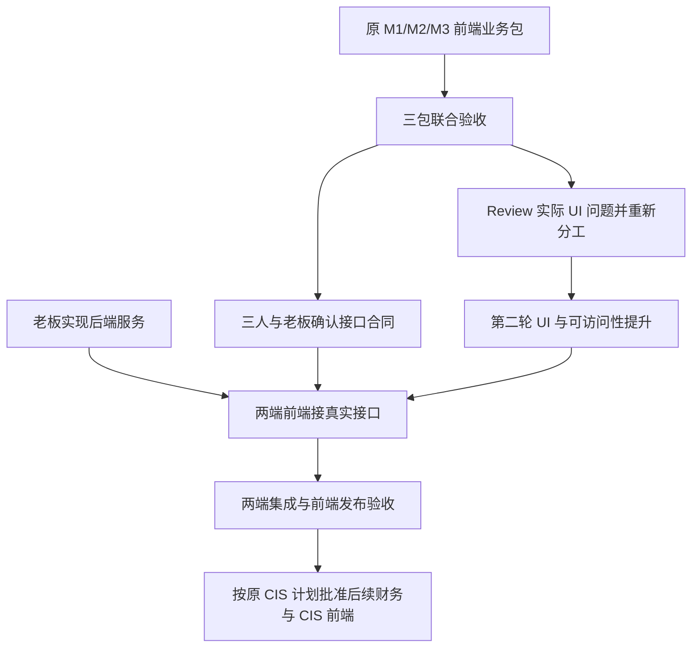

# Family Law Wise：三人前端项目总览

更新：2026-10-24，按用户最新明确的责任范围修订。

**你和两位队友只负责前端；老板负责后端。产品只有 Attorney view 和本方 Client view。** 原来的全栈分工及 61 项任务分配已由当前[前端 breakdown](project-roadmap-and-work-breakdown.md)替代。

## 1. 当前基线与这次修正

- 远端和本地 `main` 均核验为 `d6145a7`：已有两端可点击的财务资料收集原型。
- 当前分支 `feat/matter-intake-workflow` 的应用增量是 M1-01–M1-07，附带测试、production build 修复及规划文档。
- 当前分支尚未包含 M2/M3 的完整交付；“三人第一轮都完成”是讨论剩余工作的假设。
- [main 与分支逐项对照](branch-main-comparison.md)列出原有能力、三个历史提交和每个 M1 action 的具体结果。

上一版把数据库、存储、后台任务、AI 服务和运维分给三位成员，超出了你们的职责。本版将这些实现责任归老板，三人只承担页面、交互、接口消费及前端联调。

## 2. 两个产品视图

| 视图 | 使用者与主要工作 |
| --- | --- |
| Attorney | 本方律师建立事项、查看客户资料、审阅／退回材料、沟通、使用 AI；后续查看／确认财务事实及 CIS 草稿 |
| Client | 被本方律师邀请的客户填写问卷、交件、补件、查看自己的文件、与律师沟通、使用 AI |

对方、对方律师、法院、调解员等出现在法律流程研究里，是为了理解案件背景。**本项目不为他们准备账号、portal、导航、工作台或独立权限角色。** 事项中可以保留对方姓名等已知资料；数据记录不等于登录用户。

法律地图保留为[业务背景资料](nj-divorce-process-and-product-map.md)，其完整法律阶段和历史产品设想不自动进入开发 backlog。当前任务范围以本文、原三人交接和最新 frontend breakdown 为准。

## 3. 先完成你已经定下的第一轮

| 成员 | 原任务 | 第一轮业务结果 |
| --- | --- | --- |
| 1（你） | M1-01–M1-07 | 建立事项 → 问卷校验／草稿 → 答案变更同步清单 → 工作队列和设置 |
| 2 | M2-01–M2-07 | 选择并提交材料 → 律师审阅 → 退回原因 → 补交／版本历史 → 提交与收尾条件 |
| 3 | M3-01–M3-07 | 共享消息／内部备注／未读 → 文件上下文 → AI 演示和下一步导航 → 转律师消息 |

第一轮仍使用统一前端样例状态。三包合并后一起走通业务，检查关键操作的结果、状态与计数一致，手机可以操作。已有任务未过验收时先修原任务。

## 4. 第一轮完成后，剩余的前端工作

| 顺序 | 工作包 | 具体还要做什么 | 后端关系 |
| --- | --- | --- | --- |
| 联合验收 | 三包集成 | 统一事项／要求／文件版本／消息 ID；检查角色切换、返回、跨页跳转和完整交件沟通闭环 | 样例状态即可验收 |
| 第二轮 | UI 全面提升 | 实际页面 review；统一公共组件、字体／色彩／间距、导航选中态、表格／表单／对话框、移动端与键盘操作 | 先按真实问题重新分给三人，可在接口未就绪时做 |
| 接口准备 | 前端与老板的合同 | 确认字段、状态、错误、分页、权限结果、上传及 AI 事件；让 mock 与接口约定一致 | 老板提供并确认后端合同；三人提供页面需求 |
| 接口联调 | 收集业务接真实服务 | 登录／会话／邀请、事项／问卷保存、真实上传进度／重试／预览、审阅／版本冲突、消息／未读、AI 回复及历史 | 后端实现与数据持久化归老板；前端消费接口并处理状态 |
| 前端发布验收 | 两端完整回归 | 跨浏览器、刷新／重新进入、会话过期、网络失败、手机、键盘及不支持状态；保留可复现结果 | 真实保存／权限／邮件／模型结果必须有老板服务才能联合确认 |
| 后续业务阶段 | 财务与 CIS 前端 | 扩充资料／收入／两套月支出／资产负债；来源与确认界面；CIS 逐格审阅、缺项／版本、导出任务与下载 | 沿原 CIS 计划分阶段批准；老板提供事实服务、计算／映射、PDF 和存储 |

三人的后续职责仍按业务包延续：成员 1 主持公共前端合同、事项／问卷和集成；成员 2 主抓文件／审阅／版本界面；成员 3 主抓消息／AI 交互。**第二轮 UI 的具体 owner 在联合验收后，按页面问题和工作量重新定，不提前把所有 UI 塞给某一个人。**

这条路线没有新增对方门户、法院系统、送达管理、诉讼日历或完整律所 ERP。需要新增产品范围时，先明确需求并重新批准。

## 5. 开会时怎么用

1. 用同一空白事项演示第一轮三包；逐项确认原 21 个任务通过或未通过。
2. 通过后建立实际 UI 问题清单，记录页面、截图、严重度与预计工作量；当场重分三人的 UI 任务。
3. 将接口需求单独交老板：请求／响应、状态、错误、权限结果及准备日期。接口未就绪的部分明确标为依赖阻塞。
4. 每个前端任务给出 action ID、owner、reviewer、交付和验收场景；commit／PR 按同一 ID 留证。
5. 财务事实／CIS 界面按原产品阶段另行启动，当前 Financial profile 画面不作为已完成证明。

## 6. 文件入口与记录规范

- [当前权威前端 project breakdown](project-roadmap-and-work-breakdown.md)：原 21 项及后续工作包、责任／依赖／验收。
- [原三人前端交接](team-frontend-handoff.md)：第一轮的详细合同。
- [main 对比及 M1 actions](branch-main-comparison.md)：已有成果与未完成工作。
- [架构](architecture.md)、[原 CIS 计划](nj-cis-plan.md)：继续保留的产品／架构基线。
- [AGENTS.md](../AGENTS.md)、[PR 模板](../.github/pull_request_template.md)：两端、前后端职责和 action-item 记录约定。

此前 `e1db8c0` 的 production build 修复保留；Node 24.3.0 / Next 16.4.0 下的构建、28 项测试、lint 和代表性浏览器验证是上一轮实际结果。本轮只修正规划与协作文件，没有再次实现应用功能或重跑全部业务测试。
