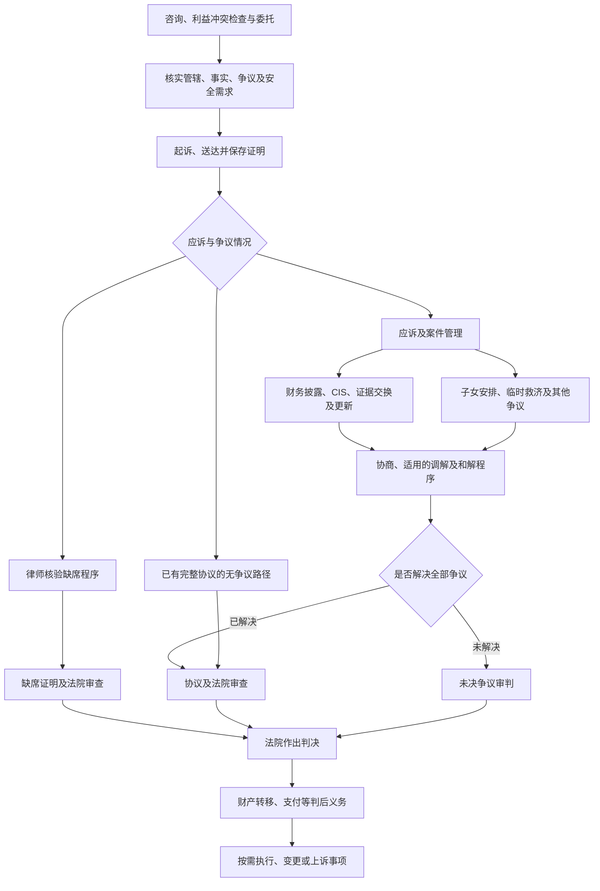
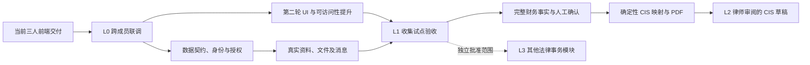

# Family Law Wise：项目全景与阅读入口

更新日期：2026-10-24。用于负责人、两位队友及业务方讨论产品范围、分工和里程碑。

## 1. 先用一句话理解产品

**Family Law Wise 当前聚焦 New Jersey 离婚案件中的财务资料收集与律师审阅；后续目标是生成可追溯、经过律师确认的 CIS 财务披露草稿及附件。**

离婚案件本身还包括受理、立案、送达、争议处理、和解或审判、判决以及判后执行。了解这些环节，是为了把收集工作放在正确的法律上下文中；是否把每个环节做成软件模块，需要另外决定范围。

| 阅读顺序 | 文档 | 应当回答的问题 |
| --- | --- | --- |
| 1 | 本文 | 我们现在在哪里，完成当前三人的工作后还差什么？ |
| 2 | [NJ 离婚流程与产品设计地图](nj-divorce-process-and-product-map.md) | 一宗 NJ 离婚案如何推进？客户、律师、法院各做什么？软件在哪些环节提供帮助？ |
| 3 | [项目拆解与实施路线图](project-roadmap-and-work-breakdown.md) | 每个工作包做什么、依赖什么、谁负责、如何验收？ |
| 基线 | [架构](architecture.md)、[NJ CIS 原计划](nj-cis-plan.md)、[当前三人前端分工](team-frontend-handoff.md) | 哪些约定继续遵守？原有任务如何承接？ |

法律流程文档由 GPT-6 Astra Ultra 承担研究与总设计工作，路线图由 GPT-6.1 Sol High 担任 principal engineer 拆解；文档是产品研究和工程规划，法律适用及上线规则仍由 NJ 执业律师确认。

已完成 GPT-6.1 Sol High 的独立工程规划审查及另一位 GPT-6 Astra Ultra 的法律／产品重点复核。前者确认原任务覆盖、依赖和范围；后者独立核验管辖与 venue、CIS 期限／签署／隐私、家暴调解和 default／判决等重点。发现的规划缺口已修正，无剩余实质性 findings；这不是对全部判例及所有程序资格的穷尽审查。

## 2. 法律案件如何走，产品位于哪里

下图是讨论用的主线；临时命令、安全事项、材料更新和和解可以在多个阶段发生。具体程序、条件及官方来源见流程地图。

其中，**当前产品最直接覆盖 G 的前半段：问客户要资料、追缺件、审阅和沟通。** 完整 CIS、法院程序及判后事项尚不能从现有页面推定已经实现。

产品状态应分别表达：

- 收集状态：客户填写、待交件、待审、退回、收集完成。
- 法律案件状态：立案、送达、争议解决、判决等，由有权限的人员维护并附依据。
- 判后义务状态：特定转移、付款或其他义务是否履行。

**收集完成、法院作出离婚判决、判后义务全部完成，是三件不同的事。**

## 3. 当前三人完成后，到底能得到什么

| 业务包 | 当前分工 | 三人全部完成后的能力 | 之后仍需建设 |
| --- | --- | --- | --- |
| 事项、邀请、问卷、清单与队列 | 成员 1，M1-01–M1-07 | 能从空白 NJ 样例事项演示资料收集的起点和规则变化 | 真实身份、授权、持久数据、可配置材料期间及服务端规则 |
| 文件提交、审阅、补交、版本及完成条件 | 成员 2，M2-01–M2-07 | 在同一应用会话里验证交件与审阅闭环 | 私有 S3、真实传输、版本一致性、并发操作、审计及恢复 |
| 真人消息与 Wise AI | 成员 3，M3-01–M3-07 | 演示共享消息、内部备注、未读及 AI 下一步导航 | 持久消息、服务端可见性、通知、真实模型与来源、会话保存及评估 |

这张表中的“三人全部完成”是规划假设。当前分支已有成员 1 的实现；成员 2、3 的交付仍须合并后按原任务逐项验收。原有 21 个任务在路线图中逐项保留，并指向生产阶段的承接工作。

## 4. 剩余工作分成四层

| 层级 | 可交付的业务结果 | 通过条件概括 |
| --- | --- | --- |
| L0：完整前端原型 | 客户和律师可以演示一轮收集、补件、审阅、沟通 | 21 项联调验收；状态、当前文件版本、消息可见性及 AI 导航一致 |
| L1：真实收集试点 | 受邀客户和律师跨设备持续协作，文件与对话可保存 | 真实认证与授权、数据隔离、私有文件、持久消息、审计、通知及恢复验证 |
| L2：律师审阅的 CIS 草稿 | 财务事实有来源，金额和映射可核对，导出版本可追溯 | 财务覆盖完整、人工确认、确定性计算与映射、表格版本管理、PDF 及附件核验 |
| L3：按业务决策扩展 | 支持更完整的离婚案件程序和判后事项 | 每个新增模块先确定法律责任、业务负责人、数据来源及独立验收条件 |

真实 AI 分为“依据当前状态提示下一步”和“有来源的一般问题咨询”，应分别验收。收集试点的关键路径不应依赖一个尚未验证的通用法律聊天机器人；AI 会话保存、权限及转律师上下文仍须纳入设计。

## 5. 如何带下一次三人会议

建议按以下顺序推进，不先平均分页面：

1. **5 分钟：对齐产品定位。** 大家用自己的话复述 L1 与 L2 的业务结果。
2. **10 分钟：核对第一轮交付。** 用同一个样例案件走 M1 → M2 → M3；未通过的任务保留原 owner。
3. **10 分钟：冻结公共约定。** 确认版本、清单、提交、完成、可见性、期间及 AI 转律师语义。
4. **15 分钟：按路线图选择下一批工作包。** 每包指定一名 owner、一名 reviewer、依赖和可演示的验收场景；负责人协调契约与集成。
5. **5 分钟：确认业务决策。** 指定 NJ 法律负责人，选择试点用户、支持材料类型、上线范围及验收日期；日期依据实际投入确定。

第二轮 UI 的共同基础、三人的后续职责及首两轮迭代建议，详见路线图。保留 Next.js / Vercel / Supabase / 私有 S3 / Resend 的既定架构。

## 6. 本次工程验证

当前分支：`feat/matter-intake-workflow`。构建修复提交：`e1db8c0`。

- 已复现原始 Turbopack CSS loader 子进程 socket 的 EPERM；采用安装版本文档支持的 `workerThreads`，保留 Tailwind 规则。
- 本机 Node 24.3.0 / Next 16.4.0 下，普通 `npm run build`、28 项测试及 lint 均通过。
- 使用 `next start` 启动 production server，浏览器验证律师及客户关键流程、样式加载，无页面或控制台错误；验证后已停止临时 production server。
- GPT-6.1 Sol High 独立检查配置、产物和 README，无待修 findings。
- `npm audit --omit=dev --json` 报告当前 Next 依赖存在 critical 级别公告，并给出 16.4.3 修复版本；这不证明当前应用可被相应方式利用。升级及回归验证纳入上线前门槛。

运行方式及 Node 升级兼容性见 [README](../README.md#production-build)。这些是本机构建和原型验证结果，不代表已经部署或完成 L1 上线验收。
