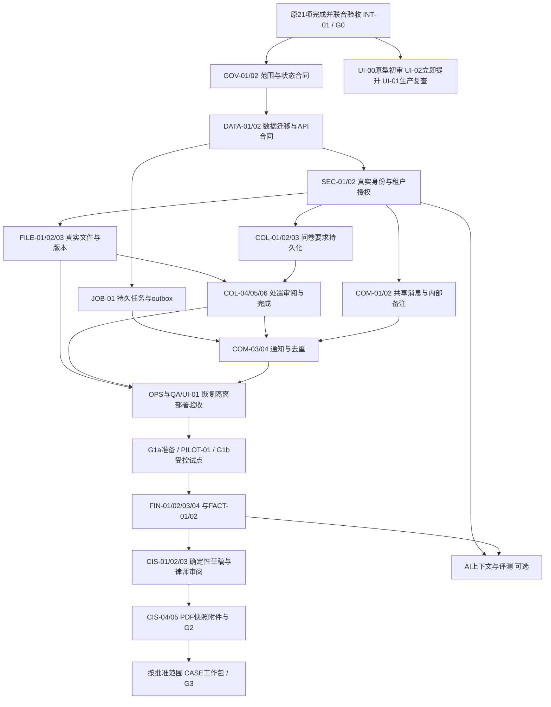

# Family Law Wise：完整项目拆解与三人实施路线

更新：2026-10-24。用途：团队排期与验收；这是规划文件，本次没有实施后端或声明生产可用。

架构依据：[architecture.md](architecture.md)；CIS 细则：[nj-cis-plan.md](nj-cis-plan.md)；原三人任务合同：[team-frontend-handoff.md](team-frontend-handoff.md)；法律全流程及官方来源：[nj-divorce-process-and-product-map.md](nj-divorce-process-and-product-map.md)。法律规则、期限和表格版本以该流程文档核验结果及执业律师批准为准。

## 1. 先对齐：现在、假设完成、最终目标

| 层次 | 可以据此排什么工作 | 不能据此声称什么 |
| --- | --- | --- |
| 当前代码基线 | `feat/matter-intake-workflow`，提交 `91e475c` 有成员 1 事项、问卷、清单及入口改动；`src/lib/store.tsx` 使用内存状态；本轮主审实际执行 28 项测试、ESLint、生产构建及代表性 Playwright 流程通过 | 证据覆盖当前分支的实际检查范围；成员 2/3 尚无本轮完整交付证据；不代表每个画面或三人原任务全部验收 |
| 本文计算剩余工作的假设 | **假定 M1-01 至 M3-07 全部完成并合入，21 项联合验收通过** | 假设不是当前完成状态；原文件的未勾选项不能直接改成已完成 |
| 假设完成后的产品 | 律师与客户在同一浏览器应用会话内走通收集、审阅、消息与 AI 演示 | 仍没有真实登录、数据库、S3 文件流、邮件、服务端隔离、真实模型或 CIS 生成 |
| 产品近期目标 | NJ 离婚财务资料收集，随后生成律师审阅的 CIS 草稿与附件索引 | 不是完整律所 ERP；账单、信托账户、CRM、官方电子立案不是试点前置条件 |
| 长期边界 | 经单独批准，增加离婚事项从咨询到判后的工作流支持 | 系统不自动判断法律权利、不代律师执业、不自动宣誓、签署、送达或向法院提交 |

三个“结束”必须分开保存：`collection_status` 收集状态、`cis_status` 草稿/审阅/导出状态、`legal_case_stage` 法律阶段。当前 `MatterStatus.COMPLETE` 只能表达已约定的收集完成，不能代表法院离婚判决或判后履行完成。

## 2. 四个可交付产品切片

| 切片 / 门槛 | 用户实际能得到什么 | 纳入 / 暂缓 | 完成证据 |
| --- | --- | --- | --- |
| L0 / G0：完整交互原型 | 原三人业务包通过，第二轮 UI 有真实问题清单 | 全部模拟身份、浏览器内存、演示 AI；不接真实客户数据 | 原 21 项及交接场景验收、实际 lint/build/test 结果 |
| L1 / G1：一家律所的真实收集试用 | 安全邀请、问卷、真实文件、接受/退回/补件、持久共享消息及邮件 | 起步只就业/工资、银行、最近适用税年；AI 可关闭；其他类别有明确不支持说明 | 隔离、恢复、移动端及邮件去重验证；一名律师监督、最多先走两个真实事项 |
| L2 / G2：律师审阅 CIS 草稿 | 完整财务收集、Part D、来源事实、确定性映射、版本 PDF、附件索引与合并附件包 | 律师确认后导出草稿；签署、正式 filing、官方支持费计算另走律师流程 | 逐格来源可追溯、金额与附件核对、律师签署验收记录；草稿与正式文书状态不混淆 |
| L3 / G3：可选案件协作 | 按获批模块支持立案/送达/日程/亲职/和解/判决/判后追踪 | 每一法律轨道单独启用；通常先做人工核验的事项与证据追踪 | 每模块律师批准规则、权限与验收样例；法院事实靠有效凭证或人工核验 |

G1 分两步：G1a 技术与法律试点准备就绪，才允许真实资料进入；G1b 律师完成两个受控试点事项，才允许扩大试用。L1 加入持久真人消息是本路线的显式范围扩展，原 `nj-cis-plan.md` 第一阶段没有承诺它；工期不能机械照搬旧计划。

优先级：P0 阻断所属发布；P1 该切片承诺的主要能力；P2 经批准的后续增强。P0 不意味着所有阶段同时开工。

## 3. 法律全流程与产品覆盖

法律阶段沿用配套流程图的 `LGL-01` 至 `LGL-14`，并行轨道不能强制做成一条直线。

| 法律阶段 | L0–L2 已规划覆盖 | 可选 L3 工作包 / 人工法律闸门 |
| --- | --- | --- |
| LGL-01 咨询、冲突检索、委托、安全分流 | 只在律师确认受理后建立收集事项；不声称已有 conflicts/engagement 系统 | CASE-01：受理记录、同意与安全沟通偏好；律师批准继续处理 |
| LGL-02 管辖、居住、离婚理由及 venue | 案件基础事实字段；系统不凭答案判断可起诉 | CASE-01：律师核验及理由记录；范围外案件分流 |
| LGL-03 诉前材料及临时/紧急救济 | 文件保管、消息；紧急安全问题立即显示官方紧急路径与安全联系，同时联系律师，不等待普通收件箱 | CASE-02：紧急/临时申请材料与命令追踪；律师决定路径 |
| LGL-04 起诉、立案 | L2 草稿导出不等于立案 | CASE-03：申请材料与法院回执登记，人工确认 filing 状态 |
| LGL-05 送达及证明 | 不自动执行送达 | CASE-04：送达任务、证明、法院认可状态由律师核验 |
| LGL-06 应诉、反诉、appearance/default | 不把“未回复门户”当 default | CASE-04：律师核验回应期限、送达及程序条件 |
| LGL-07 案件管理、会议与日程 | 收集提醒不是法院期限管理 | CASE-05：命令、事件与人工确认的期限日历 |
| LGL-08 子女、custody 与 parenting | 收集关联事实或律师点名文件，不自动推荐 custody 结果 | CASE-06：亲职材料、计划、命令及安全分流；DV 不能自动进入普通调解 |
| LGL-09 CIS、财务披露、discovery 与补正 | **L1/L2 核心**，涵盖问卷、文件、事实、草稿、导出 | CASE-07：正式 discovery 请求、答复及 CIS 更新义务追踪 |
| LGL-10 专家、估值、财产及支持争议 | 记录来源、日期、主张和专家附件；不计算法律 entitlement | CASE-08：专家委托、争议和支持费工作表附件；律师复核 |
| LGL-11 谈判、ESP、经济调解 | 现阶段消息及资料供律师使用 | CASE-09：议题、提案和会议准备；适用性与保密边界由律师定 |
| LGL-12A 和解无争议 / LGL-12B default 证明 / LGL-12C contested 审判 | CIS 草稿不覆盖三条终局程序 | CASE-09：三种路径分开追踪，协议签署不是自动获判 |
| LGL-13 最终判决 | 收集完成不改变法院案件状态 | CASE-10：判决正式副本、录入与律师确认 |
| LGL-14 判后落实、执行、修改及上诉交接 | 文件留存与权限撤销基础 | CASE-10：资产转移、退休金命令、履行任务；后续程序单独受理 |

## 4. 原三位前端负责人：21 项逐项落位

下面每行交付均是 **L0 模拟状态行为**；生产继任任务在最后一列。本表用于追踪，不替代原交接文档的具体验收步骤。

| 原 ID / 负责人 | 完成后具体交付 | 不代表已完成 | 后续生产工作 |
| --- | --- | --- | --- |
| M1-01 / 成员 1 | 统一 NJ Divorce 创建、模板及范围说明 | 法律适用规则或多州支持 | GOV-01、COL-01、CASE-01 |
| M1-02 / 成员 1 | 自定义事项名展示、搜索，兼容当事人查找 | 持久多租户查询及分页 | DATA-01、COL-02 |
| M1-03 / 成员 1 | 律师登录、客户邀请/验证码的输入、错误、过期及复制反馈演示 | 真认证、撤销、限速、邮件送达 | SEC-01、SEC-02、COM-03 |
| M1-04 / 成员 1 | 问卷必要字段、条件校验、返回/离开草稿处理 | 服务端校验、持久保存或并发冲突处理 | DATA-02、COL-03 |
| M1-05 / 成员 1 | 答案增改删同步要求，保留历史，统一样例期间 | 生产规则版本、可靠历史与事务 | COL-01、COL-03、COL-04 |
| M1-06 / 成员 1 | 工作队列、状态筛选及概览同源 | 服务端授权计数、真实跨人同步 | COL-02、COL-06 |
| M1-07 / 成员 1 | 律所及提醒设置校验、保存反馈 | 数据持久化、真实提醒调度 | DATA-01、COM-03、OPS-02 |
| M2-01 / 成员 2 | 选择/取消/替换、类型大小检查、本地预览及明确提交 | 真实传输、服务器内容验证、恶意文件隔离 | FILE-01、FILE-02 |
| M2-02 / 成员 2 | 客户文件列表/详情、关联要求、状态及样例历史 | S3 授权读取、持久文件版本 | FILE-01、FILE-03 |
| M2-03 / 成员 2 | 退回原因显示、Requests 补交、重回待审 | 持久补件、邮件通知、事务原子性 | COL-05、COM-03 |
| M2-04 / 成员 2 | 当前/旧版本与多要求关系，避免旧接受误套新版本 | 不可变对象、真实审阅版本锁及并发控制 | DATA-01、FILE-03、COL-05 |
| M2-05 / 成员 2 | 无法提供说明、编辑/补交和律师处置 | 有效法律豁免或法律披露义务已履行 | COL-04、COL-06、GOV-02 |
| M2-06 / 成员 2 | 全局文件待审队列、详情及进度联动 | 服务端权限过滤、持久审计或实时同步 | COL-02、COL-05、SEC-03 |
| M2-07 / 成员 2 | 客户提交、未解决项及律师完成条件 | 法律案件结束、CIS 完成或服务器强制约束 | COL-06、GOV-02 |
| M3-01 / 成员 3 | 双方非空样例消息、作者和时间 | 持久消息、实际跨浏览器收发 | COM-01 |
| M3-02 / 成员 3 | 全局会话查找、正确线程与未读 | 用户级 read cursor、跨设备一致性 | COM-02 |
| M3-03 / 成员 3 | 律师内部备注与客户共享消息的展示区别 | 服务端/数据库级信息隔离 | SEC-02、COM-01 |
| M3-04 / 成员 3 | 以共用文件 ID 打开正确详情 | 引用时/打开时的文件访问授权 | FILE-01、COM-01 |
| M3-05 / 成员 3 | AI 面板、话题切换、输入和明确演示回复 | 真实模型、知识检索、隐私和质量保证 | AI-01、AI-02、AI-03 |
| M3-06 / 成员 3 | 按当前内存问卷/清单选下一步并正确导航 | 授权后的真实状态上下文及过期控制 | AI-01、AI-03、COL-02 |
| M3-07 / 成员 3 | 携带可编辑问题转入事项律师消息 | 律师已收到、已读、承诺响应或紧急服务 | COM-01、COM-03、AI-03 |

所有 21 项合并后新增 `INT-01` 联合验收任务：成员 1 组织，成员 2/3 交叉验收；用空白事项完整走问卷→文件→退回→补交→接受→共享消息→AI 导航；对照原第 8 节留证。产出是 G0 的验收记录和未通过问题清单，不是再次扩充首轮功能。

## 5. 后续 WBS 的责任和共同约定

暂定 A＝成员 1（领域、数据、API 与集成），B＝成员 2（文件、后台任务、部署运维），C＝成员 3（身份接入、消息、AI 和 UI）。这是拟分工，需确认三人实际熟练度；不能因为前端任务完成就假设已具备生产安全经验。

每项主责至少有一名其他成员复核；安全/RLS 由 A+C，文件/恢复由 A+B，财务/PDF 由 A+B+律师，交互/可访问性由 B+C。指定试点执业律师拥有法律规则与文书验收权，产品负责人确认范围；两者不是默认由工程师兼任。

表中“依赖”是进入验收的最低条件；同组任务可按冻结合同先做模拟接入，但不得据此跳过发布闸门。法律阶段列说明使用场景，不表示任务本身作出法律判断。

### 5.1 治理与生产基础（L1，G1a 前必须完成）

| ID / 优先级 | 动作与可审查交付 | 依赖 | 主责 / 复核 | 验收证据 | 法律阶段 / 阻塞决定 |
| --- | --- | --- | --- | --- | --- |
| GOV-01 / P0 | 确认 NJ Divorce、试点律所、输入类别、数据使用与退出边界；建立范围及决定登记 | 无 | A+产品+律师 / B,C | 具名批准的范围、纳入/排除列表及试点协议 | LGL-01/02/09；D01 |
| GOV-02 / P0 | 批准提交/接受/退回/豁免/重开、当前版本及三套状态机；写允许转换和拒绝原因 | GOV-01、INT-01 | A+B+律师 / C | 每个转换有前置条件、角色、历史影响与测试场景 | LGL-09；D02/03 |
| DATA-01 / P0 | 设计/迁移 firm、membership、matter、party、邀请、答案版本、requirement、document/version/link、review、message/read、audit/outbox/job 表；金额用精确小数 | GOV-02 | A / B,C | ERD、外键/唯一性/租户约束、空库建表/升级与回滚演练；答案、文件、抽取、事实不混存 | 全阶段基础；D03/04 |
| DATA-02 / P0 | 冻结 API/服务命令、授权上下文、服务器校验、错误码、分页、并发版本和幂等键；替换内存边界的接入计划 | DATA-01 | A / B,C | 类型/契约样例及消费者测试；重复命令、过期版本明确返回冲突 | LGL-09；D02 |
| SEC-01 / P0 | Supabase Auth 律师登录、客户邀请+一次性验证码、过期/撤销/限速、退出与会话策略；取消 demo token 作为权限 | DATA-01、DATA-02 | C / A | 真实授权用户登录、过期/撤销/重放拒绝；日志不含验证码；跨浏览器会话测试 | LGL-01/09；D04 |
| SEC-02 / P0 | Next.js 服务端逐操作检查 firm membership+matter access+role；Postgres RLS 同时约束读写，内部备注独立策略 | SEC-01、DATA-01 | A+C / B | 两律所/同律所两客户、猜 ID、直接 API/数据库访问、撤销访问均拒绝；service_role 旁路逐项审查 | 全阶段；D04 |
| SEC-03 / P0 | 追加式业务审计：谁在何时对哪个版本做什么；安全访问日志与普通活动展示分开，敏感正文脱敏 | DATA-02、SEC-02 | A / B | 接受/退回/下载/导出/权限变更可追踪；前端不能改历史；访问日志不泄露文件正文 | 全阶段；D05 |
| JOB-01 / P0 | TypeScript 持久任务与 outbox：事务入队、租约/重试/超时/失败队列、去重、人工重跑；选定 Vercel 兼容执行机制 | DATA-01、DATA-02 | B / A | worker 中断后可恢复，重复执行不重复发信/写版本；失败可见；执行平台选择记录 | LGL-09；D06 |

### 5.2 真实文件与收集闭环（L1，G1a）

| ID / 优先级 | 动作与可审查交付 | 依赖 | 主责 / 复核 | 验收证据 | 法律阶段 / 阻塞决定 |
| --- | --- | --- | --- | --- | --- |
| FILE-01 / P0 | S3 私有桶、租户/事项对象键；服务器检查权限后签发短时上传/下载；文件元数据与正文分离 | SEC-02、DATA-02 | B / A | 上传→刷新→另一授权设备打开真实 PDF；跨租户/到期链接拒绝；撤销后不能签发新链接 | LGL-09；D04/05 |
| FILE-02 / P0 | 上传 intent→隔离→内容校验→完成登记：真实类型/大小/校验和、恶意文件策略、取消/中断/孤儿清理；失败文件不得预览/抽取 | FILE-01、JOB-01 | B / C | 改后缀、超大、恶意/损坏文件、中断/重复完成均有预期结果；DB 与对象可对账 | LGL-09；D05/06 |
| FILE-03 / P0 | 不可变文档版本、当前版本指针、版本级要求关联和审阅；禁止覆写已接受对象；保留替换历史 | FILE-02、GOV-02 | B / A | 已接受 v1 换 v2 后 v2 待审，v1 决定保留；多要求共享时各自链接和规则明确 | LGL-09；D03/05 |
| COL-01 / P0 | 首版问卷/模板/要求规则版本化，按事项基准计算工资单、税年、逐月账户材料，保存生成依据 | GOV-01、DATA-02 | A / 律师,B | 固定时钟/跨年样例准确；既有事项保留规则版本，更新明确影响 | LGL-09；D01/03 |
| COL-02 / P0 | 事项/当事人/问卷/清单/文件/活动 API 接入现有两端，服务端同源查询及权限过滤计数 | SEC-02、DATA-02、COL-01 | A / C | 真实用户跨设备/刷新持续一致；搜索/分页/空态；浏览器不决定租户或进度 | LGL-09；D02/04 |
| COL-03 / P0 | 持久草稿/分段提交/服务端条件校验/答案修订，联动清单时保留关联文档与历史；并发编辑明确提示 | COL-01、COL-02 | A / B | 添加/改名/删除账户、返回/刷新、两页冲突、不完整提交均按规则保留 | LGL-09；D02/03 |
| COL-04 / P0 | 要求豁免/不适用/无法提供说明，区分客户陈述与律师决定；规则变化不静默删除已处理要求 | GOV-02、COL-03 | A+B / 律师 | 未提供不会自动当接受；律师原因和时间留痕，重新要求可恢复历史 | LGL-09；D02 |
| COL-05 / P0 | 接受/退回/补件的服务器事务，校验当前文档版本，生成活动/审计/outbox；全局审阅队列接入 | FILE-03、COL-02、SEC-03 | B / A | 两律师同时处理、旧页面接受、退回再补交均无串状态；故障不出现半更新 | LGL-09；D02/03 |
| COL-06 / P0 | 服务器计算完成条件、缺项列表、例外原因与重开；分别显示客户提交、律师接受、收集完成 | COL-04、COL-05 | A+B / C,律师 | 未解决要求不能误完成；获批例外可审计；更新文件/答案按规则重开 | LGL-09；D02 |

短时下载地址一经签发，在其有效期内可能仍可用；撤销会员不等于已发地址瞬间失效。SEC-02/FILE-01 必须验证有效期边界，是否需要更强的逐次代理访问由 D04 决定，不能写成绝对实时撤销保证。

### 5.3 真人消息与通知（L1，G1a）

| ID / 优先级 | 动作与可审查交付 | 依赖 | 主责 / 复核 | 验收证据 | 法律阶段 / 阻塞决定 |
| --- | --- | --- | --- | --- | --- |
| COM-01 / P0 | 持久事项线程/共享消息/内部备注/文件引用；创建、查询、导出都在服务端按可见性授权 | SEC-02、DATA-02、FILE-01 | C / A | 两真实角色跨浏览器收发；客户 API、未读、搜索、通知中都无内部备注；引用文件再次授权 | 全阶段协作；D04/07 |
| COM-02 / P1 | 每用户 read cursor、全局收件箱、排序分页；先支持发送后刷新/轮询，是否实时另定 | COM-01 | C / B | 两设备读消息后未读一致，晚到/重复请求不丢消息，切事项无串线 | 全阶段协作；D07 |
| COM-03 / P0 | Resend 邀请/补件汇总/共享新消息通知，outbox 去重、退信处理、用户偏好与投递状态 | SEC-01、JOB-01、COL-05、COM-01 | C / B | 缺三件只发一封；重试不重复；无内部备注/敏感附件；退信有可见补救 | LGL-01/09；D07 |
| COM-04 / P1 | 缺件提醒计划、时区/频率/停止条件、完成后取消；将“已投递”与“客户已读/律师已答”分开 | COM-03、COL-06 | C / A | 配置参数驱动任务；已完成/撤销邀请不再提醒；重跑不重复发送 | LGL-09；D07 |

### 5.4 可运行、可恢复、可验收（L1 起，每个后续阶段重过相关闸门）

| ID / 优先级 | 动作与可审查交付 | 依赖 | 主责 / 复核 | 验收证据 | 法律阶段 / 阻塞决定 |
| --- | --- | --- | --- | --- | --- |
| OPS-01 / P0 | 独立 dev/staging/prod Supabase、S3、Resend/任务配置；Vercel 环境、CI lint/test/build/契约/迁移门禁、部署回滚 | DATA-01、SEC-02、JOB-01 | B / A | preview 无生产访问；从干净环境部署成功；迁移前备份及应用兼容回滚演练 | 全阶段；D06/08 |
| OPS-02 / P0 | 密钥最小权限、服务器保密、轮换/吊销手册、成本与容量上限、依赖/供应链检查 | OPS-01 | B / C | 构建产物/日志无密钥，轮换不丢任务，误用生产凭证能阻断 | 全阶段；D06/08 |
| OPS-03 / P0 | DB 备份+S3 对象/版本保留及恢复对账；确定 RPO/RTO、恢复负责人、事故与客户通知路径 | FILE-03、OPS-01 | B / A | 隔离环境实际恢复一个事项及文件、审阅/消息记录，记录耗时和缺失量 | 全阶段；D05/08 |
| OPS-04 / P0 | API/任务/邮件监测、错误追踪、关联 ID、告警和 runbook；日志脱敏且告警有人接 | JOB-01、COM-03、OPS-01 | B / C | 注入任务/上传/邮件失败，告警到达并按手册恢复；计费异常可暂停 | 全阶段；D08 |
| OPS-05 / P0 | 保留/归档/导出/删除政策及法律保全；会员离开和事项关闭后的访问管理 | SEC-02、SEC-03、FILE-03 | A+B+律师 / C | 删除需获批、保全阻止删除、备份/旧 PDF 范围写清；到期对象/孤儿处理可审计 | LGL-01/09/14；D05 |
| OPS-06 / P0 | 修复生产依赖 advisory：核验并升级 Next 与 eslint-config-next 配套补丁，固定 Node/构建环境、复查实验性 worker 配置；本次只排期 | OPS-01、INT-01 | B / A | 官方公告/补丁核验、锁文件变更、audit 复查及 lint/test/build/E2E；Node 变更后重验构建进程策略 | 全阶段；D06/08 |
| QA-01 / P0 | 单元/契约/数据库 RLS/真实集成/E2E 分层；安全负例、事务并发及数据一致性验收，使用合成资料 | COL-06、COM-03、OPS-01 | A,B,C 交叉 | CI 结果、真实 S3/API 流、跨租户拒绝及两角色手机流程证据；无仅靠 mock 的上线结论 | 全阶段；D08 |
| UI-01 / P0 | 真实接入后复验表单标签、键盘/焦点、屏幕阅读器、对比度、错误/加载/空态、敏感预览及上传结果 | UI-00、COL-06、COM-02 | C / B | 键盘完成真实问卷/上传/消息、手机完成核心流程；无阻断性可访问性问题 | LGL-09；D08 |
| PILOT-01 / P0 | 冻结试点范围、律师与客户培训、反馈/退出及故障兜底；先 G1a，再两个真实事项 G1b | G1a 全部任务 | A+律师 / B,C | 逐项完成审阅及收集；记录缺件是否仍靠外部清单、失败与修复；获得扩大试用决定 | LGL-09；D01/08 |

当前依赖风险证据：本轮主审执行 `npm audit --omit=dev --json`，`next@16.4.0` 得到 direct critical 聚合结果，涉及 `GHSA-2464-fhr4-w9xw`、`GHSA-p3m5-59mp-jv5r`、`GHSA-673q-mjm6-r5xr`；当时工具建议 `16.4.3`。这是包级公告匹配，**不能据此断言当前业务存在可利用漏洞**。OPS-06 须重新核验适用公告和可用补丁后升级，当前构建通过不消除此发布阻断。

当前构建在 Node `24.3.0`、Next 实验性 `workerThreads` 配置下通过；现有 Next 实现对 Node `>=24.13.1` 会回退 child processes，升级 Node 或 Next 后必须重跑构建/部署验证。这个环境兼容风险与上述依赖公告分别验收，不能用修复其中一项替代另一项。

### 5.5 扩充财务资料与确认事实（L2，先于映射）

| ID / 优先级 | 动作与可审查交付 | 依赖 | 主责 / 复核 | 验收证据 | 法律阶段 / 阻塞决定 |
| --- | --- | --- | --- | --- | --- |
| FIN-01 / P0 | 建立 Part A/B 案件/家庭/就业字段字典，区分客户与另一方已知信息、未知和未核验；Part F 特殊问题/其他需要由律师撰写与审批，客户可提供待审说明 | GOV-01、COL-03 | A / 律师,C | 法律基础日期/子女/雇主/保险等字段可追踪来源；未知不伪造；F 文本保留作者/版本/审阅状态，内部策略不自动进入导出 | LGL-02/08/09；D09 |
| FIN-02 / P0 | 在同一规则引擎扩 Part E 全部资产/七类负债、所有权/主张/估价日期及 Part G 附件；按期间收集 | PILOT-01、COL-01、FILE-03 | A+B / 律师 | 对照字段矩阵覆盖房产、银行、车辆、有形财产、证券、退休金/IRA、生意、现金值保险、应收、crypto、子女账户/信托、税项及负债；附件有接受证据 | LGL-09/10；D09 |
| FIN-03 / P0 | Part D 双生活水平、A–D 支出表、频率换算/24 月依据/避免与 Part C 重复；保存金额来源和估计说明 | FIN-01、DATA-02 | A+C / 律师 | 律师批准公式与舍入；周×4.3、24 月平均等代表样例、两列总计可复算 | LGL-09/10；D09 |
| FIN-05 / P0 | 补齐 Part C 收入采集/审阅：上一公历年与当前年度/YTD、gross/net/税费和逐项扣款、三发薪期/频率、奖金佣金是否包含、非工资各来源及 joint-tax 栏口径；金额绑定来源与期间 | FIN-01、FACT-01、COL-03 | A+C / 律师,B | 工资/Medicare wages、三期周均、YTD 扣款、bonus/commission、利息租金等样例可复算；联合报税栏与各方归属经律师确认；Part C/Part D 不重复计扣款 | LGL-09/10；D09/10 |
| FACT-01 / P0 | 事实 schema：精确金额/币种/期间/归属/估价日期、文件版本+页码或问卷版本、估计标记、确认人/时刻 | FIN-01、DATA-01 | A / B,律师 | 多来源/冲突/未知及缺日期样例；取值可点回原始来源而非只有自由文本 | LGL-09；D09/10 |
| FACT-02 / P0 | 待确认→律师确认→更正/取代流程；确认值不可被后续上传/抽取静默覆盖，来源变更标 stale | FACT-01、FILE-03、FIN-02、FIN-05 | A+B / 律师 | 工资、余额、按揭、信用卡四类从来源到确认再更正可追踪；旧导出保留旧快照 | LGL-09/10；D10 |
| FIN-04 / P1 | 前端财务画像接真实确认流、缺项/冲突工作队列；人工录入与来源关联完整可用 | FACT-02、FIN-03 | C / A,律师 | 关闭所有 AI 后仍可完成完整财务事实与支出审阅 | LGL-09；D10 |

### 5.6 CIS 确定性映射、审阅与版本导出（L2，G2）

| ID / 优先级 | 动作与可审查交付 | 依赖 | 主责 / 复核 | 验收证据 | 法律阶段 / 阻塞决定 |
| --- | --- | --- | --- | --- | --- |
| CIS-01 / P0 | 钉死官方 CN 10482 表格/指引版本、原件来源/日期/校验值；逐格字典→事实/答案映射、空缺规则、公式及升级策略 | FIN-01/02/03/05、FACT-02 | A+律师 / B | Part A–G 每格状态为支持/空白并说明原因/人工；律师签批映射，无模型直接填表 | LGL-09；D09/10 |
| CIS-02 / P0 | 确定性生成 immutable draft snapshot，保存事实/规则/模板版本；完整性与 stale 检查、金额计算及舍入 | CIS-01 | A / B | 合成金标准逐格对比；收入频率、joint tax、资产/负债合计、缺来源保持空白；同快照重算一致 | LGL-09；D10 |
| CIS-03 / P0 | 律师逐格审阅、来源侧栏、缺项原因及更正写回事实新版本；冻结可导出快照 | CIS-02、FIN-04 | C / A,律师 | 抽查 C 周收入、D 月费用、E 账户/负债，改值留旧版；未经批准不得称可签署/提交 | LGL-09；D10 |
| CIS-04 / P0 | TS 后台 CIS PDF、附件索引及已接受附件的合并 PDF 包；接受版本快照、分页字体/表格版本、按文书类别/接收对象/规则例外审查 PII；三项 certification 共用一个 dated/signed block 并留空 | CIS-03、JOB-01、FILE-03 | B / 律师,C | 渲染逐页核对、数字不截断、附件与冻结索引一致；律师确认隐私与例外，保留保密 CIS 所需资料；不得误造三处签名；草稿标识清楚 | LGL-09；D05/10 |
| CIS-05 / P0 | 导出记录/权限/审计、不可变 S3 版本、后续更新差异与重导出、下载失败重试 | CIS-04、SEC-03、OPS-03 | B / A | 来源改动后旧 PDF 可追溯，新导出为新版；请求重试不造重复版本；律师离线核对并批准 G2 | LGL-09/14；D10 |

本次法律研究已核验 CN 10482 为 12 页、Revised 08/2025、Effective 09/01/2025（来源及获取证据见法律流程地图）；**实施 CIS-01 时仍重新核验官方现行版本**，核验不通过先更新字典/映射/验收样本。导出草稿的律师批准只是本产品 G2；客户签署、宣誓/认证、法院受理与正式提交状态分别记录，不能互相推导。

CIS 隐私处理不能把所有附件当普通公开文书一律涂黑：表内第一项 certification 对本表及其附件存在例外，应按文书类别、接收对象、适用规则及例外由律师批准遮挡方案。保密 CIS 必需信息不能被通用遮挡破坏；公开提交版本/向对方披露版本分别核验。该细则用于补充旧 CIS 计划阶段 6 的概括说明，不改变“系统不代签、不保证自动符合法院规则”的边界。

### 5.7 真实 AI（可选增强，不能阻断 L1/L2 的人工路径）

| ID / 优先级 | 动作与可审查交付 | 依赖 | 主责 / 复核 | 验收证据 | 法律阶段 / 阻塞决定 |
| --- | --- | --- | --- | --- | --- |
| AI-01 / P1 | 从当前授权事项构造最小上下文；先用确定性规则算下一步，过滤角色/可见性；对答案记录资料版本 | SEC-02、COL-06、COM-01 | C / A | 跨租户/内部备注泄露、陈旧下一步、恶意文档指令测试；状态变更后上下文失效 | LGL-09；D11 |
| AI-02 / P2 | 获批模型+OCR/解析后台分类/抽取：字段/页码/置信与失败队列，写 candidate 而非 confirmed fact | JOB-01、FILE-02、FACT-01 | B+C / A,律师 | 合成/获批匿名评测集、人工核对准确度、错误和成本；possible 账户未确认前不入 CIS | LGL-09；D11 |
| AI-03 / P2 | 一般问答从律师批准、版本化法律信息库检索；给来源/适用范围/不确定性；个案建议转律师，紧急安全问题立即显示经核验的官方紧急路径与安全联系，不等待普通收件箱 | AI-01、AI-05、COM-01、GOV-01 | C+律师 / A | 检索/引用一致、拒答/转接、安全紧急分流和提示注入评测；不冒充律师答复；交接需用户确认发送 | LGL-01/03/09；D11 |
| AI-05 / P1（启用会话 AI 时） | 持久化 ai_thread/turn/message、作者/可见性、响应/错误状态、模型及 source/context-version 引用；定义列表/重开/删除/保留与租户/用户/事项授权；转共享线程只复制用户确认的问题 | AI-01、DATA-01、SEC-02、OPS-05 | C / A,B | 刷新/跨设备重开同一授权会话；失败/取消与重试留痕、不重复回答；另一客户/律所及未授权同事不可读；内部备注/私有 AI 回答不随转律师泄露；到期按批准政策处理 | 全阶段协作；D04/05/11 |
| AI-04 / P0（启用 AI 时） | 批准供应商数据条款、留存/训练/地域政策、预算、质量阈值、追踪/反馈与 kill switch | AI-01，依启用范围加 AI-02/03/05 | C+产品+律师 / B | 授权数据范围与评测签批；超预算/不可用可关闭，人工收集/事实/CIS 不受阻 | 全阶段；D05/11 |

真实模型接入是一项独立发布决定；原 M3 的 UI 完成只减少面板/导航工作，不减少授权上下文、法律质量、供应商隐私和评测工作。

### 5.8 第二轮 UI（G0 后排入，关键可用性属于各阶段门禁）

| ID / 优先级 | 动作与可审查交付 | 依赖 | 主责 / 复核 | 验收证据 | 法律阶段 / 阻塞决定 |
| --- | --- | --- | --- | --- | --- |
| UI-00 / P1 | G0 后立即做原型桌面/手机 UI review，登记导航/层级/公共组件、文案、键盘焦点、点击区域与可读性问题 | INT-01 | C / A,B | 有问题编号、截图、严重度及三人第二轮分工；不等待生产后端完成 | LGL-09；D08 |
| UI-02 / P1 | 根据 UI-00 原型 review 立即排视觉/导航/公共组件改进；分清真实持久、演示、上传中、待律师确认和法院状态文案 | UI-00 | C / A,B | 有问题编号/前后截图/影响页面；原业务联合流程回归通过 | 全阶段；D08 |
| UI-03 / P1 | 对真实接入、财务审阅、CIS 和可选案件页分轮做响应式/可访问性验收，保持共用组件 | 所属功能任务、UI-02 | C / B | 每一发布有手机/桌面、键盘/焦点和文书可读性记录 | 全阶段；D08 |

先修阻断操作或理解的 UI 问题；大规模配色/动效不抢占隔离、真实文件与财务来源关键路径。UI-02/03 是交付任务，不把每个人重新拆成只负责某个角色的页面。

### 5.9 完整离婚流程的可选工作包（L3，各包单独 G3）

以下不是 G1/G2 的隐藏前置条件。开始前用对应法律流程章节确认适用性、权限、资料范围和律师签批人。

| ID / 优先级 | 动作与可审查交付 | 依赖 | 主责 / 复核 | 验收证据 | 法律阶段 / 阻塞决定 |
| --- | --- | --- | --- | --- | --- |
| CASE-01 / P2 | 咨询/冲突检索与委托状态记录、安全联系偏好、管辖/venue/理由核验表及人工决策；明确不是自动冲突消除 | GOV-01、SEC-02、OPS-05 | A+C / 律师 | 未受理/利益冲突/安全风险案件不能误入普通流程；律师核验签名与理由 | LGL-01/02；D12 |
| CASE-02 / P2 | 诉前证据、临时/紧急请求、现行保护/支持命令及人工分流；紧急联系人与普通收件箱区分 | CASE-01、COM-01、FILE-03 | C / 律师,B | DV/紧急场景不自动走普通调解/等待提醒；权限和提示经律师批准 | LGL-03/08；D12 |
| CASE-03 / P2 | 起诉材料版本、律师批准、提交任务及人工上传官方 receipt；保存案件号/受理日期及证据 | CASE-01、FILE-03、SEC-03 | A / 律师,B | 草稿/已签/已提交/已受理四态不混淆；只凭有效证据改变法院状态 | LGL-04；D12 |
| CASE-04 / P2 | 送达任务/证明/回应材料与事件来源；期限由律师确认 trigger/规则后生成；default 条件逐项人工核验 | CASE-03、CASE-05 | A+C / 律师 | 送达失败/异议/反诉/default 路径留痕；门户未读不产生 default | LGL-05/06；D12 |
| CASE-05 / P2 | 案件事件/命令/会议/期限台账、责任人与提醒；每项记录来源、触发日、时区和律师核验 | CASE-01、COM-04、SEC-03 | C / A,律师 | 修改法院命令后旧期限不静默消失；假日/服务触发等情形人工核验 | LGL-07；D12 |
| CASE-06 / P2 | custody/parenting 事实、计划草稿、法庭命令和所需课程/调解任务；受保护资料可见性与安全例外 | CASE-02、CASE-05 | C / 律师,A | 有/无子女与 DV 场景分流；不推荐自动 custody 结果；不假定对方获门户访问 | LGL-08；D12 |
| CASE-07 / P2 | 正式 discovery 请求/答复、异议/逾期与 CIS 补正/交换台账；区分给律师上传与向对方正式披露 | G2、CASE-05 | A+B / 律师 | 每次交换有批准版本/对象/时间证据；新事实可触发律师复查但不自动发送 | LGL-09；D10/12 |
| CASE-08 / P2 | 专家/估值、争议资产/负债/支持费资料及工作表附件、意见版本与来源；不新造支持费计算器 | FACT-02、CASE-07 | B / 律师,A | 专家意见与确认事实区分，估价日可见；采用法院工作表须另立验证项目 | LGL-10；D12 |
| CASE-09 / P2 | 谈判/ESP/调解议题与保密工作区；分别追踪和解无争议、default 证明、contested 审判准备 | CASE-05/07，按需 CASE-06/08 | C+A / 律师 | 三条路径独立验收；内部策略不向客户/对方泄露；签协议不标法院终结 | LGL-11/12；D12 |
| CASE-10 / P2 | 最终判决/日期与正式副本核验，判后义务、财产/退休金分割、执行/修改/上诉交接和关闭/重开 | CASE-09、OPS-05 | A+B / 律师,C | 判决与履行逐项分开；QDRO 等独立任务有负责人/证据；新程序经律师批准 | LGL-13/14；D12 |

不随 L3 默认加入 billing、trust accounting、通用 CRM、电子签名平台、多州规则或 eCourts 集成。它们必须有独立商业需求、合规评估、实施与验收计划。

## 6. 关键路径与可以并行的内容

资源层面的关键约束：A 同时负责领域/数据/集成，不能并行推进三套未冻结 schema；B 的上传校验/后台恢复先于 AI 抽取和 PDF；C 的认证/真实消息优先于真实 AI。L3 的 CASE-01/05 可在 L1 稳定后单独立项；图中从 G2 接入 L3 是默认产品顺序，并非所有案件追踪技术上依赖 CIS。

安全、审计、恢复、运维和可用性不是最后一周才加；从第一条真实数据链路起随包实现。没有 G1a 不导入真实客户资料，没有 G2 不承诺可交给律师核对的完整 CIS 产品。

## 7. 三人容量与阶段估算方法

假设三人均可承担全栈任务、同一时间各主攻一个包；每周合计 15 人日，先按约 9–11 人日可计划交付，余量覆盖评审、集成、测试、会议与故障。律师/产品每周提供固定反馈时段；外部等待不算工程吞吐。

| 阶段 | A / 成员 1 | B / 成员 2 | C / 成员 3 | 排期出口 |
| --- | --- | --- | --- | --- |
| G0 合并及决策 | 公共合同、事项/问卷与联调 | 文件/版本交接 | 消息/AI 演示与手机检查 | 不完整包先补验收，不能当生产工作已省掉 |
| L1 基础及闭环 | 数据/领域/授权复核、持久问卷 | S3/版本/任务/运维 | Auth 接入、消息/邮件/可访问性 | 完整 G1a 证据；试点再过 G1b |
| L2 财务到草稿 | 财务字典、来源事实、确定性映射 | 文档来源/PDF/恢复及版本 | 支出输入、审阅 UI 与可选 AI | 律师逐格审阅和离线 PDF 核对 |
| 可选 L3 | 案件状态与法律合同 | 证据/专家/判后文件流 | 日程/协作与分流界面 | 一个法律模块一个 G3，不同时开全部 |

估算只使用相对尺：S＝约 1–3 工程人日，M＝约 4–8，L＝约 9–15；超过 L 先拆薄。数字不含律师审批、采购/账号、试点等待和未知返工，安全审查/恢复不得压缩为装饰性检查。

首轮只对 Sprint 1/2 形成容量承诺：每个 Sprint 假设两周，三人合计约 18–22 可计划人日；把未验证工作标记 spike 并限时。完成两轮取得吞吐后，再用剩余工作量/实际吞吐给出 L1/L2 区间。旧计划“两人 8–10 个月”是当时假设，**不能换算成现在三人的发布日期承诺**。

## 8. 第一天会议：必须形成的决定与责任人

会议建议 90 分钟；参与三名工程成员、产品负责人、试点执业律师。未到场的法律批准人保留待确认，不能由工程师默认同意。

| 决定 ID | 需要拿出的具体结果 | 决策负责人 / 执行负责人 | 阻断什么 |
| --- | --- | --- | --- |
| D01 | NJ Divorce、单律所/两事项试点、第一批三类资料；明确 client onboarding 与受理关系 | 产品+律师 / A | GOV-01、L1 范围 |
| D02 | 可提交条件、无法提供/豁免、例外完成/重开、客户提交与法律完结的区别 | 律师+产品 / A,B | GOV-02、COL-04/06 |
| D03 | 日期基准/税年、规则版本、答案删除历史、一文件多要求及替换接受规则 | 律师+产品 / A,B | COL-01/03、FILE-03 |
| D04 | firm/matter 角色矩阵、内部备注、邀请撤销、会话/下载链接时效及受保护信息 | 律师+产品 / A,C | SEC-01/02、FILE-01、COM-01 |
| D05 | 文件允许范围/大小、恶意文件处理、PII 按文书类别/接收对象/规则例外处理、留存/删除/保全、供应商数据政策 | 律师+产品 / B | FILE-02、OPS-05、AI-04 |
| D06 | dev/staging/prod 账号与预算、TS 持久任务执行机制、邮件域名及访问负责人 | 产品+工程 / B | JOB-01、OPS-01/02 |
| D07 | 消息 SLA/非紧急提示、共享/内部分类、通知模板、提醒频率、实时是否首版必需 | 产品+律师 / C | COM-01–04 |
| D08 | G1a/G1b 检查清单、RPO/RTO/值守、支持浏览器/手机、可访问性目标及试点兜底 | 产品+工程+律师 / B,C | 上线与扩大试点 |
| D09 | CN 10482 现行版本、字段字典、估计/未知/另一方信息、Part D 口径 | 律师 / A | FIN、CIS-01 |
| D10 | 事实确认权、更正和 stale、导出阻断/可空白字段、草稿/签署/提交边界、三项 certification 共用的日期/签名区 | 律师 / A,B | FACT-02、CIS-01–05 |
| D11 | AI 是否启用、允许用途/资料、供应商条款与评测门槛、转律师/紧急边界 | 律师+产品 / C | 真实 AI 上线，**不阻断人工 L1/L2** |
| D12 | L3 优先法律轨道、规则维护与批准人、哪些状态需法院证据、哪些是律师人工判断 | 律师+产品 / A | 对应 CASE 包；不阻断收集试点 |

会议安排：先 15 分钟复现 G0 和实际缺口；25 分钟决定 D01–04；20 分钟 D05–08；15 分钟明确 D09–12 的批准人/交付日；最后 15 分钟冻结 Sprint 1 容量、合同所有者和验收证据位置。无法决定的项写清负责人、候选方案与所阻断任务。

## 9. 前两个 Sprint：做薄的真实链路

以下从 INT-01 验收后的起点计算；若 M2/M3 未完成，先完成其原任务及集成，不能把缺口悄悄计入“都做完”的基线。

| Sprint | A 交付 | B 交付 | C 交付 | 联合演示 / 出口 |
| --- | --- | --- | --- | --- |
| 1，第 1–2 周 | GOV-01/02、DATA-01 最小 firm/member/matter/requirement/document schema，DATA-02 上传/问卷命令合同，SEC-02 最小授权 | OPS-01 dev/staging 骨架、FILE-01 私有上传/读取垂直链路；JOB-01 机制限时验证 | SEC-01 真实律师/客户会话最小链路，接入一个问卷分段；COM-01 数据/可见性合同 | 用合成资料：真实邀请→存一段问卷→传 PDF→刷新后律师可开；另一客户/律所直接请求被拒；记录未完成项，无真实客户试点 |
| 2，第 3–4 周 | COL-01/03 最小动态账户与版本冲突；SEC-02 租户/角色负例；GOV-02 完成条件合同 | FILE-02/03 最小校验与不可变版本、COL-05 接受/退回事务；任务中断/重复场景 | COM-01 持久共享/内部消息最小链路，COM-03 单封补件 outbox；UI-01 手机交接检查 | 合成双角色走退回→补交→接受；重复发送不重复邮件、客户拿不到内部备注；列出 G1a 仍缺 OPS/QA/保留等，不宣称已可试点 |

每个 Sprint 开始只承诺容量内的薄片，schema/授权与单条真实链路优先。表里是验证目标，若拆解估算超过 18–22 人日，减少类别/样例与平行目标，保持安全和恢复验收；不能用删验收来凑日期。

## 10. 防止三人并行冲突：唯一事实源和交接合同

建议在实施对应任务时新增以下工件；本次只约定位置，不预建空实现或额外服务。

| 工件 / 唯一事实源 | 主持人 | 合作约定 |
| --- | --- | --- |
| `docs/decisions.md`（拟建） | A 汇总，产品/律师署名 | 每个 D 编号写决定、日期、适用版本、未决项及被影响任务；口头结论及时落盘 |
| `docs/data-contracts.md`（拟建）+ 受版本控制的 DB migrations | A | `firm_id/matter_id/document_version_id`、角色/状态/金额/日期口径先冻结；B/C 提交小变更，禁止并行手改同一 migration |
| `docs/api-contracts.md`（拟建）+ schema/契约测试 | A，B/C 负责各自领域 | 方法/输入/输出/错误、鉴权、幂等和 version 前置条件；mock 与真实服务实现同一合同 |
| 原 `src/lib/types.ts/store.tsx/seed.ts` | A 协调 | 仍只代表演示/客户端状态；服务端迁移分领域小批次，不能继续让 reducer 承担真实授权 |
| 文件/任务/运维合同 | B | 上传完成、当前版本、短时预览、job 结果/失败事件统一；C 不自己拼 S3 链接或复制审阅逻辑 |
| 消息/AI/通知合同 | C | `visibility`、作者、文件版本引用、read cursor、通知事件及 AI 上下文版本统一；内部备注不能只靠 UI filter |
| `docs/release-evidence/`（拟建） | 每包主责，其他成员复核 | 每条任务附提交/环境、步骤、实际结果、截图/日志/报告、未通过点及批准者；区分读取、推理与执行证据 |

同一业务状态只由服务端命令和数据库事务产生，页面队列读取同源结果。事件包含稳定 ID、租户/事项/版本、actor 和时间；用户正文不写进任务日志。schema 变更先约定向后兼容/迁移顺序，再接 UI，避免三人各建一套“完成”或“当前文件”。

## 11. 发布 Go / No-Go

| 门槛 | Go 所需最小证据 | 必须 No-Go 的例子 | 批准人 |
| --- | --- | --- | --- |
| G0 | 原 21 项、INT-01 及实际 lint/test/build；失败项有解决记录 | M2/M3 只有设计图或有入口但闭环不通 | 三人交叉验收，A 记录 |
| G1a | GOV/D01–08 已批；DATA/SEC/FILE/COL/JOB/COM 与 OPS-01–06、QA-01、UI-01 的 L1 门槛通过；可回滚、可恢复、有兜底 | 任何跨租户读写、真实文件拿不回、内部备注泄露、重试重复发信、无法恢复、手机无法上传、未处置生产依赖公告 | 产品+律师+三名工程主责 |
| G1b | PILOT-01 两个受控事项完成律师审阅与收集；支持/失败和外部清单依赖被记录并处置 | 通过“手工后台改状态”掩盖关键缺陷或客户仍需另走完整资料清单 | 律师+产品，工程提供证据 |
| G2 | FIN/FACT/CIS 已承诺功能及全部 P0、适用 UI/OPS/QA 回归、现行表格核验、逐格来源/公式/版式/隐私及附件快照经律师验收 | 没来源的数自动填、覆盖确认事实、旧新附件混合、草稿被标已签/已 filed、误设三处签名、错误公开隐私或通用遮挡破坏 CIS 必需信息、金额截断 | 执业律师+产品，A/B/C 提供证据 |
| AI 启用 | 获批用途对应 AI-01/02/03/05 与 AI-04，授权/隐私/质量评测、人工路径与关闭开关 | 租户上下文泄露、无来源法律建议、模型自动写确认事实、关 AI 后无法完成业务 | 律师+产品+工程安全复核 |
| 每包 G3 | D12 批准、对应法律规则/命令/证据状态、权限、期限与例外样例、相关 OPS/QA 回归 | 上传草稿当已 filing、未送达当 default、DV 自动进入普通调解、协议当判决、判决当全部履行 | 负责该法律轨道的律师+产品 |

## 12. 本文完成检查与后续使用

每次排期先确认三件事：当前切片、该切片 P0 和对应 D 决定是否已过、下一条可执行验收链路是什么。不得把所有表中任务同时开工。

本次规划按三轮自查并处理主审发现的收入/会话存储/UI 依赖缺口：① 全 21 项与“假设完成后”边界；② 法律全流程与架构/数据/权限/文件/CIS 的依赖覆盖；③ 三人资源冲突、验收证据和发布闸门。发布时仍以真实执行结果填验收记录；文档本身不是生产验证。
