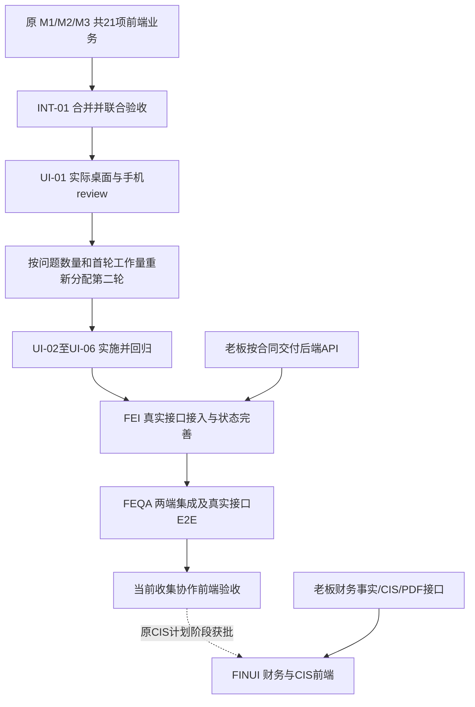

# Family Law Wise：三人前端项目拆解与后续交付路线

更新：2026-10-24。本文是当前**前端分工与剩余工作**的执行依据。

**范围更正：三位队友只负责前端，老板负责全部后端。** 本文替代此前同名文件中把认证、数据库、存储、任务、AI 引擎、CIS 引擎及运维分给三人的全栈方案；旧方案的 61 项全栈/集成任务及原分工不再是当前 backlog。首轮仍以原 21 项为准，不因这次规划增加首轮业务。

配套资料：[原三人前端任务](team-frontend-handoff.md)、[架构基线](architecture.md)、[后续 CIS 阶段计划](nj-cis-plan.md)、[项目阅读入口](project-overview.md)。[NJ 法律流程地图](nj-divorce-process-and-product-map.md) 用于理解业务背景，不能据此扩充本轮页面、角色或模块。

## 1. 产品、责任与当前证据

产品只有**律师端与本方客户端**。对方当事人及对方律师可以作为事项资料中的姓名或业务背景，不增加其账户、角色、门户、工作区、消息空间或开发任务。

三位前端成员使用 A/B/C 简称：A＝成员 1，B＝成员 2，C＝成员 3。每个人的工作均可覆盖相关律师端和客户端；不能把三人重新拆成“一个人只做律师端、另一个人只做客户端”。老板不计入这三位前端成员。

| 事实层次 | 当前可以使用的结论 | 验证边界 |
| --- | --- | --- |
| 已有代码 | `feat/matter-intake-workflow` 的 `91e475c` 包含成员 1 首轮业务改动；现有共享状态仍在浏览器内存 | M1 已有实现证据；M2/M3 尚无本轮完整交付及联合验收证据 |
| 已有工程检查 | 上一轮已实际运行 28 项测试、ESLint、普通 production build，以及代表性 Playwright 流程，通过；本轮仅修订文档 | 只覆盖此前实际执行的代码及场景；不等于原 21 项全部验收，不等于生产上线 |
| 本文分析起点 | **假定原 M1-01 至 M3-07 都完成并合入，再分析还剩哪些前端工作** | 这是排期假设，不改写 M2/M3 的实际完成状态 |
| 假定首轮完成后 | 同一浏览器应用会话内演示事项、问卷、清单、交件/审阅、真人消息和 AI 指引 | 刷新持久化、跨设备同步、真正认证/上传/邮件/模型/CIS 都依赖老板后端，不由演示证明 |

当前 `MatterStatus.COMPLETE` 表示约定范围内的收集完成。前端必须区分客户提交、律师接受、收集完成、CIS 草稿审阅/导出；这些都不自动表示签署、送达、法院提交或离婚结束。无需为此新增完整法律案件状态管理模块。

## 2. 全项目接口边界：老板交付什么，前端接什么

架构保持 Next.js/Vercel、Supabase Postgres/Auth、私有 AWS S3、Resend、TypeScript 后台任务。即使服务端代码与页面同仓库，也不意味着三位前端成员承担服务端实现。

下表 B01–B09 是**老板提供的接口依赖编号**，不是分给三人的后端任务清单。

| 依赖 | 老板负责交付的后端能力 | 三名前端负责的接入边界 |
| --- | --- | --- |
| B01 身份与会话 | 认证服务、邀请/验证码、会话、过期/撤销、服务器权限、租户与事项隔离/RLS | 登录/邀请表单、提交请求、过期/错误/无权限画面、退出及返回路径；不实现认证服务或授权规则 |
| B02 事项与收集 | 数据库/迁移、事项/问卷/要求/规则/设置 API、服务器校验、版本冲突、权威进度及完成条件 | 读取/编辑/提交、呈现服务端结果、保留未成功输入、冲突提示和刷新；不设计/实施数据库或规则引擎 |
| B03 文件与审阅 | 私有 S3、上传许可/完成确认、真实内容校验、文档版本、短时读取、接受/退回事务及存储安全 | 文件选择、上传请求/传输、进度/取消/重试、预览与版本/审阅页面；不建桶、签名 URL 或后台校验 |
| B04 真人消息 | 会话/消息持久化、共享/内部可见性、文件引用、分页、未读及更新接口 | 两端线程、收件箱、发送反馈、历史加载/重开、未读和文件打开；UI 隐藏不等于服务端权限 |
| B05 真实 AI 与会话 | 模型 API、授权上下文、知识/来源、流式或异步协议、AI 历史存储、错误/限额、关闭状态 | AI 输入/响应/来源/历史页面、等待/取消/失败/重试、下一步导航、可编辑转律师消息；不实现模型/检索/抽取服务 |
| B06 通知与后台状态 | Resend 邮件、提醒、任务队列、幂等/重试及任务状态 API | 显示后端返回的邀请/通知/任务结果与失败反馈；不发真实邮件或运行后台任务 |
| B07 财务事实 | 财务字段与来源 schema、金额/期间口径、事实确认/更正、冲突与计算 API | 后续获批的收入/预算/资产负债/来源展示和编辑/确认交互；不计算权威金额或实现事实引擎 |
| B08 CIS 与导出 | 表格版本、确定性映射、草稿快照、校验、PDF/附件合并、导出权限和任务/下载 API | 后续获批的草稿审阅、来源、缺项、版本、生成状态和下载 UI；不实现映射或 PDF 引擎 |
| B09 运行与安全 | 生产环境/密钥/部署/备份恢复/监控/保留删除政策、生产安全及依赖风险处置 | 前端构建/测试及接口问题报告、按批准策略展示状态；不承担生产基础设施或后端运行保障 |

前端可以用约定 mock 开发界面，但“需要后端有这个行为”与“前端已经实现这个行为”必须分开记录。真实持久化、权限隔离、文件内容校验、消息可见性与任务幂等必须由老板后端保证，不能用本地状态或隐藏按钮替代。

## 3. 交付顺序：首轮业务 → 联合验收 → 第二轮 UI → 真实接入

老板可独立安排后端开发。三人可以提前讨论接口需求，但不能因此改变“先完成原 21 项，再验收，再依据实际问题分配 UI”的顺序。后续接口阶段按老板可交付能力分批推进；后续财务/CIS 不是首轮新增验收条件。

## 4. 第一轮：原 21 项逐项保留

下列任务范围和验收仍以原交接文档为准。A 当前已有实现；B/C 的实际交付需验收。表中“完成后”全部指前端演示，不含老板后端。

| 原 ID / 当前负责人 | 完成后交付的前端行为 | 不能据此认为已完成 |
| --- | --- | --- |
| M1-01 / A | NJ Divorce 创建、模板和说明范围一致，不支持选项清楚 | 法律适用引擎或多州支持 |
| M1-02 / A | 自定义事项名可显示、搜索，并可按当事人查找 | 服务器持久搜索或权限过滤 |
| M1-03 / A | 律师登录、邀请/验证码输入与错误/过期演示、准备/确认/复制/返回反馈 | 真实认证、验证码、邮件发送 |
| M1-04 / A | 必要与条件字段校验，返回/继续/离开的草稿处理明确 | 数据库保存、服务器校验或并发处理 |
| M1-05 / A | 答案增改删同步清单，关联历史及样例日期口径一致 | 后端规则版本、事务或持久历史 |
| M1-06 / A | 待审/等客户/完成等筛选、队列及概览同源 | 真实跨设备同步或服务端权威计数 |
| M1-07 / A | 律所/提醒设置的输入校验与内存保存反馈 | 持久配置、提醒调度或发送 |
| M2-01 / B | 文件选择/取消/替换、本地类型大小提示/预览、明确提交和待审反馈 | 真实 S3 上传、内容扫描或后端校验 |
| M2-02 / B | 客户文件列表/详情、关联要求、预览与历史入口；区分本地和样例 | 真实私有文件读取或持久版本 |
| M2-03 / B | 客户看见退回原因并补交，双方恢复待审显示 | 持久事务或补件邮件 |
| M2-04 / B | 当前/历史版本及多要求关系清楚，新文件不误用旧接受结果 | 服务器版本一致性或并发锁 |
| M2-05 / B | 无法提供说明、编辑/补交与律师处置结果明确 | 法律义务已豁免或服务器决定已保存 |
| M2-06 / B | 全局待审队列进入正确文件，清单/进度/活动联动 | 后端权限过滤或可靠审计 |
| M2-07 / B | 客户提交、未解决项、律师完成/例外原因符合商定条件 | 离婚案件结束或真实服务器强制约束 |
| M3-01 / C | 共享样例消息、作者/时间、同一应用会话查看与回复 | 持久消息或跨浏览器收发 |
| M3-02 / C | 全局会话入口、正确线程与未读显示 | 服务器未读游标或跨设备一致性 |
| M3-03 / C | 律师共享消息/内部备注区分，客户端只展示共享消息 | 真实服务端/数据库可见性隔离 |
| M3-04 / C | 消息关联共用文件 ID，打开正确文件详情 | 文件读取授权或真实短时链接 |
| M3-05 / C | 两端 AI 面板、话题切换、输入及明确标注的预设演示回复 | 真实模型、检索、抽取或会话存储 |
| M3-06 / C | 按当前问卷/清单/文件状态给下一步并正确导航 | 后端最新上下文或真实法律建议 |
| M3-07 / C | 携带可编辑问题转入本事项律师消息 | 律师已收到/已读、承诺答复或紧急响应 |

原 21 项不能因后面新增 UI/接口任务而重复结算或扩成生产实现。发现首轮遗漏，回到相应原 ID 修复并复验。

### 4.1 三包联合验收

| ID | 前端动作与交付物 | 前端依赖 | 老板依赖 | 主责 / 复核 | 验收证据 |
| --- | --- | --- | --- | --- | --- |
| INT-01 | 三包合并，用空白事项演示问卷→清单→提交→退回→补交→接受→消息→AI 导航 | 原 21 项 | 无，使用共同 mock | A 组织，B/C 交叉验收 | 原第 8 节逐项步骤/实际结果；lint/test/build；失败项对应原 ID |
| INT-02 | 复核共享 ID、状态、导航、当前文件版本、未读及活动；修复交接处冲突 | INT-01 | 无 | 各原业务 owner 修复，另一人复核 | 同一会话切换两端无串事项/文件/消息，无错误完成状态 |
| INT-03 | 建立通过/未通过清单和实际工作量记录，整理第二轮 UI review 的样例及入口 | INT-01、INT-02 | 无 | A 汇总，B/C 确认 | 三人确认首轮通过，或保留明确阻塞项；不把 mock 通过记为后端通过 |

INT-01/02 不要求刷新后保留或不同浏览器同步；这些是后续真实接口阶段。首轮应满足基本手机可读、按钮可操作和错误可理解，全面视觉提升在联合验收后安排。

## 5. 第二轮 UI：先看实际问题，再重新分工

先完成 UI-01，再由三人按问题严重度、涉及页面、首轮实际工作量及熟悉程度确定 UI-02–06 的 owner/reviewer。下表的 A/B/C 仅是**讨论用候选分配**，不能在 review 前当作已冻结任务。

| ID | 前端动作与交付物 | 前端依赖 | 老板依赖 | 主责候选 / 复核候选 | 验收证据 |
| --- | --- | --- | --- | --- | --- |
| UI-01 | 两端桌面/手机 review，按页面记录层级、导航、排版、文字、间距、颜色、点击区和状态问题，形成第二轮分工表 | INT-03 | 无 | A 组织，三人共同 review | 每项有截图/复现路径/严重度/工作量/owner，UI 范围已确认 |
| UI-02 | 公共组件/布局/导航统一，当前事项、当前位置和返回路径清楚；复用现有骨架 | UI-01 后确定 | 无 | 候选 A / C | 两端导航无丢上下文，公共修改列出影响页并回归 |
| UI-03 | 事项/问卷/清单/设置的信息层级、表单提示、保存反馈和状态文案改善 | UI-01 后确定 | 无，mock 可验 | 候选 A / B | 原 M1 流程通过，字段/按钮/保存结果易理解 |
| UI-04 | 文件选择/预览/审阅/补件/版本/进度呈现统一，手机上关键操作可达 | UI-01 后确定 | 无，mock 可验 | 候选 B / A | 原 M2 场景通过；当前/旧版本、退回原因及要求进度不混淆 |
| UI-05 | 线程/收件箱/内部备注/AI 面板布局、空态和转律师编辑体验改善 | UI-01 后确定 | 无，mock 可验 | 候选 C / B | 原 M3 场景通过；话题/事项不串，演示标识保留 |
| UI-06 | 跨页面响应式/可访问性：标签、键盘、焦点、对比度、错误位置、加载/空/找不到状态 | UI-02–05 | 无，mock 可验 | review 后分给三人，交叉检查 | 代表性桌面/手机与键盘操作证据；无核心流程阻断 |

UI-02–06 是问题分类与候选工作包，不预设每类都需要修改；review 未发现问题的类别记录检查结果，不为凑分工增加改动。

建议会议中把公共问题集中给一个协调人，页面业务问题仍由熟悉该流程的人处理；按实际工作量调平，而非强行平均分页面。不能用 UI 重做引入新业务或取消已验收行为。

## 6. 真实 API 接入：三人仍然只写前端

本节从“前端需要显示/调用什么”拆分工作；老板按 B01–B09 提供实现和可用环境。前端 owner 均在第二轮分工时确认，以下沿原业务熟悉度给候选，不等于后端 owner。

| ID | 前端动作与交付物 | 前端依赖 | 老板依赖 | 前端主责候选 / 复核 | 验收证据 |
| --- | --- | --- | --- | --- | --- |
| FEI-01 | 对接老板 API 合同，整理请求/响应类型、样例、错误码、分页、时间、状态及版本字段；前端 mock/真实接入共用约定 | INT-03、UI-01 | B01–B08 相关合同，由老板批准 | A 协调，B/C 各认领自己的消费者 | 前端所需字段/失败状态均有合同样例；缺接口列入老板依赖，不自行建服务 |
| FEI-02 | 登录/邀请/验证码接真实请求，处理过期/撤销、限速提示、无权限、退出及恢复到原任务 | FEI-01、相关 UI | B01 | 候选 A / C | 两端正确进入对应区域；会话到期不显示成功，未提交输入按批准策略处理 |
| FEI-03 | 事项列表/搜索/队列/概览/设置读写真实 API，统一 loading/空态/错误与服务器返回的状态/计数 | FEI-01、FEI-02 | B02 | 候选 A / B | 刷新后显示服务端数据；修改失败不假保存；搜索/分页/无记录可用 |
| FEI-04 | 问卷草稿/提交和清单变更接 API，显示保存中/成功/失败、服务端字段错误及版本冲突；支持明确重载/重试 | FEI-03 | B02 | 候选 A / B | 返回/刷新及另一会话修改后行为明确；冲突不静默覆盖；清单以服务端结果为准 |
| FEI-05 | 文件传输前端：按老板协议申请上传、执行传输、完成确认，显示进度/取消/断网/失败/重试与处理状态 | FEI-01、FEI-02、相关 UI | B03、涉及异步状态时 B06 | 候选 B / A | 真实文件传输和取消/重试；100% 传输未确认前不显示提交成功；失败保留可理解状态 |
| FEI-06 | 文件列表/预览/当前与历史版本、接受/退回/无法提供/完成接 API；处理链接失效、权限拒绝、版本已变化和操作冲突 | FEI-03、FEI-05 | B02、B03 | 候选 B / A | 新版本不会继承旧接受；打开过期预览可重新请求；失败不留下虚假完成计数 |
| FEI-07 | 真人历史会话 UI：线程/收件箱分页、刷新重开、发送/失败重试、用户级未读、文件版本引用；按老板协议刷新或订阅 | FEI-01、FEI-02、FEI-06 | B04；通知结果展示依赖 B06 | 候选 C / B | 两真实浏览器角色收发/重开，重复点击无重复视觉消息；客户 UI 不显示内部备注 |
| FEI-08 | 真实 AI 运行 UI：请求/流式或异步响应、等待/停止/失败/重试/限额/关闭、引用来源与下一步；区分演示/真实返回 | FEI-01、FEI-02、相关 UI | B05，老板提供状态与响应协议 | 候选 C / A | 模型不可用仍可用原收集功能；部分响应/取消不冒充完整答案；入口来自当前事项 |
| FEI-09 | AI 历史 UI：列表/重开/分页、消息/来源/上下文版本及失败记录展示；按老板保留/删除接口呈现结果 | FEI-08 | B05 的持久历史及授权接口 | 候选 C / A | 刷新/跨设备重开的是服务器历史；无权/已删除记录有清楚反馈；不以 localStorage 假装持久化 |
| FEI-10 | AI 问题转律师：只把用户选择并可编辑的问题放进共享消息草稿，显示接收对象；提交后展示实际发送结果 | FEI-07、FEI-08 | B04、B05 的允许上下文和发送合同 | 候选 C / B | 未点击发送不发消息；内部备注/完整私有 AI 会话不自动附带；紧急安全入口不等待普通收件箱 |
| FEI-11 | 邀请/缺件/提醒等后端结果的通用状态展示；导出状态只在后续获批阶段接入；说明已请求、处理中、成功或失败，不伪称已送达/已读 | FEI-01、相关流程 | B06；导出阶段另依赖 B08 | 由所属流程前端 owner 负责，另一人复核 | 请求成功与邮件投递/客户已读明确区分，失败可按合同重试或联系处理 |

浏览器传输到老板签发的地址属于 FEI-05 的前端调用；创建 S3 桶、签发/验证许可、扫描文件和写数据库仍是老板工作。服务器拒绝的操作不能靠客户端状态“补成功”。

### 6.1 接口交接必须明确的内容

| 约定 | 老板提供/批准 | 前端交付 |
| --- | --- | --- |
| 稳定标识与状态 | 事项/要求/文件版本/会话/消息 ID、状态含义、服务器完成条件 | 页面和跳转共用 ID；计数不写死、不自行推导法律完成 |
| 输入与错误 | 必填/格式/条件规则、字段错误、无权限/找不到/过期/冲突/限额结构 | 可执行的表单反馈与重试/返回路径，不显示内部异常正文 |
| 保存与冲突 | 保存结果/版本字段、更新冲突、幂等请求或重试协议 | 只在成功后显示已保存；保留失败输入，冲突由用户明确处理 |
| 文件与任务 | 上传/确认/处理/预览协议、任务状态、过期/失败/重试 | 上传进度/完成不混淆，轮询/订阅依合同，离开页面行为清楚 |
| 消息与 AI | 可见性、未读、历史、来源、上下文版本、响应方式和转律师可带内容 | 双端状态、历史重开和草稿预览；不把客户端隐藏说成权限隔离 |
| 开发与联调 | 测试环境、测试用户/合成资料、接口版本、变更通知和后端联系人 | 可复现请求与截图/日志、消费者测试、明确阻塞接口编号 |

合同由老板定稿；A 协调前端需求，B/C 各自检查文件/消息/AI 的消费者需求。缺合同先列差异或使用明确标记的 mock，不由三人代写后端补齐。

## 7. 真实接入后的前端集成与验收

| ID | 前端动作与交付物 | 前端依赖 | 老板依赖 | 前端主责 / 复核 | 验收证据 |
| --- | --- | --- | --- | --- | --- |
| FEQA-01 | 验证 mock 与真实 API 模式标识、类型/错误合同及前端构建/静态检查；移除当前交付路径的假成功提示 | 相关 FEI、UI 任务 | 对应接口可联调 | 各业务 owner，另一人复核 | 实际 lint/test/build、消费者测试及失败状态检查；不把 mock 结果当真实接入 |
| FEQA-02 | 两端真实接口 E2E：邀请→问卷→上传→退回→补交→接受→提交/完成→消息与历史 | FEI-02–07、FEI-11 | B01–B04、B06，老板提供测试环境 | A 组织，B/C 交叉执行 | 使用两个独立浏览器会话，刷新后资料和历史存在；截图/执行结果/缺陷记录 |
| FEQA-03 | AI 运行/历史/转律师及失败路径 E2E，不与真人消息、其他事项或内部备注混淆 | FEI-08–10 | B04、B05 | C 组织，A/B 复核 | 等待/部分响应/错误/取消/关闭/重开/发送场景；内部内容不自动转入共享线程 |
| FEQA-04 | 真实接入后手机/键盘/焦点/错误/加载/重试及回归验收，整理剩余前端问题 | FEQA-02；AI 启用时加 FEQA-03 | 对应 API 稳定可用 | 三人按实际页面分工，交叉复核 | 手机完成核心流程；无阻断操作问题；记录客户端检查与老板后端验收的区别 |

前端 E2E 可以发现隔离或持久化问题并提交复现证据；不能代替老板的数据库/RLS/存储安全、备份恢复及生产验收。AI 未获批启用时，FEQA-03 记为该能力未启用，不得用 mock 回复声称真实 AI 已验收。

## 8. 后续财务与 CIS：阶段批准后才做前端

沿用 `nj-cis-plan.md` 的后续阶段，不加入首轮 21 项。范围只有本方客户填报与律师查看/审阅/更正/导出结果；数据、计算、确认规则、映射和 PDF 均由老板提供。

| ID | 后续前端动作与交付物 | 前端依赖 | 老板依赖 | 前端主责候选 / 复核 | 验收证据 |
| --- | --- | --- | --- | --- | --- |
| FINUI-01 | 按获批字段接入案件/家庭/就业信息，以及 Part E 资产/负债和 Part G 附件的补充表单、清单与关联展示 | 对应阶段获批、现有收集前端稳定 | B02、B03、B07 的字段/规则与来源接口 | 候选 A / B | 多条记录、未知/不适用/估计、期间和归属展示明确；只保存服务器接受结果 |
| FINUI-02 | Part C 收入表单/审阅：上一公历年、当前/YTD、扣款、发薪频率、奖金/佣金、非工资收入和联合报税栏 | FINUI-01、阶段获批 | B07 提供口径、校验、计算和来源 | 候选 A / C | 原始来源/期间可查看；转换与合计显示后端结果；不在 UI 发明收入分配公式 |
| FINUI-03 | Part D 两套生活预算、分类输入、单位/频率、估计及来源说明，展示计算明细和合计 | FINUI-01、阶段获批 | B07 的支出分类、换算、舍入及防重复口径 | 候选 A/C，review 后定 / B | 两列不混淆、字段错误可定位，按批准样例显示结果；不另做权威预算计算引擎 |
| FINUI-04 | 财务事实候选/已确认/需复查/历史展示，打开文件版本/页码或问卷来源；律师确认/更正交互 | FINUI-01/02/03，阶段获批 | B07 的确认/更正/历史及 B03 来源访问 | 候选 B / A | 点击来源可核对；新来源/冲突不悄悄显示为已确认；确认成功/失败反馈真实 |
| FINUI-05 | Part F 特殊问题/其他需要的文本输入、律师审阅与版本显示；区分客户待审说明和获批内容 | FINUI-01、阶段获批 | B07 的字段/可见性/版本合同 | 候选 A / C | 文本作者/状态明确，内部内容不自动进入客户视图或导出 |
| FINUI-06 | CIS 草稿审阅 UI：格子/来源侧栏、缺项原因、估计标记、更正入口、表格版本与快照状态 | FINUI-02–05、对应阶段获批 | B08 草稿/缺项/快照、B07 更正接口 | 候选 C / A,B | 代表性 C/D/E 格子能看来源，修改只经 API；缺来源不显示伪造值；不实现确定性映射 |
| FINUI-07 | 导出任务/版本列表/预览/下载、PDF 与附件索引/合并包结果、失败重试和旧版提示 | FINUI-06、导出阶段获批 | B08 的 PDF/附件/版本/下载，B06 任务状态 | 候选 B / C | 导出中/失败/成功区分；旧版本可追溯；下载过期有重新请求路径；不生成 PDF |
| FINUI-08 | 财务/CIS 前端 E2E 与手机/可访问性回归，按律师批准样例核对展示和操作 | 已启用 FINUI 功能 | B07/B08 可联调、老板/律师提供验收样例 | 三人按本轮实际分配，交叉复核 | 输入→来源→审阅→更正→导出状态完整；问题按 UI/API/业务规则分别交对应负责人 |

CIS 页面和下载结果应明确“草稿/待审/已导出”，不能显示成“已签署/已向法院提交”。官方表格的三项 certification 共用一个 DATED/SIGNED 区，前端不自行增加签署步骤或电子签名系统。隐私输出、现行表格、签署和附件规则由老板与负责律师决定，前端按合同展示，不能自行通用涂黑。

## 9. 三人后续职责如何安排

| 阶段 | A：成员 1 | B：成员 2 | C：成员 3 | 老板的独立依赖 |
| --- | --- | --- | --- | --- |
| 首轮 | 原 M1 七项；协调共享前端约定 | 原 M2 七项 | 原 M3 七项 | 无真实后端要求 |
| 首轮合并验收 | 组织联合场景、记录 M1 交接问题 | 文件/版本与 M1/M3 交接检查 | 消息/AI 与文件/事项交接检查 | 无，仍为演示验收 |
| 第二轮 UI | 参与 review，按实际工作量重新认领 | 同左，优先利用文件流程熟悉度 | 同左，优先利用消息/AI 熟悉度 | 无，UI 不等待后端实现 |
| 后续 API 接入 | 候选事项/问卷/会话入口消费者，协调合同 | 候选上传/预览/审阅消费者 | 候选消息/AI/历史消费者 | 老板提供并批准相关 API/测试环境 |
| 获批财务/CIS UI | 按字段与页面工作量再分配 | 按来源/审阅/导出页面再分配 | 按预算/草稿/交互页面再分配 | 老板提供财务/CIS/PDF API，业务方批准范围 |

这些是前端职责建议。人员投入、截止日和后续 owner 由三人看完实际问题后确认；本文件不预设固定工期，不沿用旧全栈估算或“两人 8–10 个月”作当前承诺。

## 10. 开会与交接的实际步骤

1. 按原 21 项复现当前状态，记录 M1 已实现与 M2/M3 未验收的区别；未通过仍归原任务 owner。
2. 三包合入并执行 INT-01–03；记录代码位置、步骤、实际结果、剩余问题，分开记录构建通过与业务通过。
3. 首轮通过后执行 UI-01，依据截图、严重度和实际工作量填写第二轮 owner/reviewer，再实施 UI-02–06。
4. 向老板提交 FEI-01 的消费者需求表：需要哪个接口/字段/错误/版本，属于哪个 B 编号，何时可联调由老板确认。
5. UI 回归后按可用 API 分批接入；演示通过、真实接入通过、后端未就绪分别记录，不互相代替。
6. 财务/CIS 仅在原计划相应阶段批准后挑选 FINUI 包，另开该阶段前端分工，不能回灌到首轮。

| 交接工件 | 负责人 | 必须包含 |
| --- | --- | --- |
| 原任务/联合验收记录 | 各前端 owner，A 汇总 | ID、实现位置、验证步骤、实际结果、未完成点；M2/M3 未验收不能勾完成 |
| 第二轮 UI 问题及分工表 | 三人 review 后确认 | 问题截图、页面、严重度、工作量、owner/reviewer、回归场景 |
| 前端 API 消费者合同/差异表 | A 汇总，B/C 各自领域；老板批准合同 | 请求/响应/错误/版本/状态样例、mock/真实标识、对应 B 依赖及阻塞说明 |
| 真实接口与后续阶段验收记录 | 相关前端 owner，另一人复核 | 环境、用户角色、合成数据、E2E 结果、失败证据及前端/后端问题归属 |

公共 `types.ts/store.tsx/seed.ts`、导航和 UI 组件的前端修改仍由 A 协调合入；B/C 负责自己领域的小批次变更，先约定字段/事件再改公共文件。老板的后端 schema/API 由老板维护，前端不得另建第二套权威业务规则。

## 11. 分阶段验收门槛

| 门槛 | 前端通过条件 | 不能声称什么 |
| --- | --- | --- |
| 首轮业务通过 | 原 21 项和 INT-01–03，基本手机可用、共享状态与两端路径正确，实际工程检查留证 | 真实认证/文件/消息/AI 已部署可用 |
| 第二轮 UI 通过 | review 后认领的问题完成，UI-02–06 对应回归通过，无核心操作/可访问性阻断 | 没有后端也能证明真实持久化或权限安全 |
| 真实收集协作前端通过 | 已启用 FEI 功能与 FEQA 回归，真实接口下刷新/两端会话/错误恢复可用；未就绪依赖明确 | 老板的生产安全、备份恢复、模型质量等后端门槛已自动通过 |
| 真实 AI 前端通过 | FEI-08–10 与 FEQA-03 按实际启用范围验收，来源/历史/失败/转律师状态正确 | 模型法律建议正确或后台隐私/权限已由 UI 保证 |
| 财务/CIS 前端通过 | 对应获批 FINUI 包及其 E2E 通过，来源/审阅/导出状态与老板 API 一致 | 前端实现了财务/CIS/PDF 引擎，或导出等于签署/正式 filing |

生产能否接真实客户资料，由老板及业务负责人按后端与产品上线条件另行决定；三名前端只提交自己实际完成的证据。

## 12. 本文自查范围

本次仅修订规划与协作文件：① 保留原 21 项与先业务后 UI 的顺序；② 每项主责均为前端、老板接口依赖独立；③ 真实收集/消息/AI 历史及后续财务/CIS 都只有前端消费者任务。没有把完整离婚法律流程变成默认 backlog，没有新增对方门户或 ERP 模块，也没有修改应用或后端。
